# formant

`formant` 是 Oolaf 的 **Chrome MV3 扩展**：智能翻译、iTab 风格 New Tab、V2EX Plus 自动签到与页面增强、公开 GitHub 文件/目录 ZIP 下载、轻量鼠标手势、轻量代理切换、轻量扩展管理、站点 Cookie/Storage 提取、自动翻页（AutoPagerize）、Telegram Web 受限图片/视频保存、X/Twitter 时间线推文 Google 翻译、Discord 当前频道手动 Google 翻译、elitepvpers 帖子标题与回复 Google 翻译、linux.do 话题列表表格换皮、bbs.hupu.com 帖子与板块简洁版式、freefq.com 帖子一键导出 TXT、huavod.com 控制台解锁、Gemini 生成图下载去水印、mail.google.com 顶栏显示当前邮箱、本地 Axure HTML 原型、DevTools 里的 Vue 组件检查、HLS（m3u8 / m3u / txt）播放、网页滚动截屏、扩展内 Word / Excel / PPT（oolafOffice）、新标签页识图反解提示词、开发者工具箱（二维码、时间戳、JSON 美化 / 对比、文件对比、图片 Base64、编码转换、油猴脚本）、书签同步到 mono、网页图片另存为 PNG/JPG、JSON / JS / CSS 美化（DevTools + 整页查看器），以及可扩展的俚语词库包。

后端能力依赖 [`aphelios - mono`](../aphelios%20-%20mono) 的 Client API（`x-oolaf-client-key`）与 Admin 里的 Formant 配置组。

## 快速开始

先把扩展加载进 Chrome 或 Edge，再在「同步」里填 Client API Key。密钥只存在本机，不要写进仓库。

### 1. 第一次配置

Chrome → `chrome://extensions` → 打开「开发者模式」→「加载已解压的扩展程序」→ 选择本仓库的 `formant` 目录。然后点 popup 齿轮打开 `option.html#sync`：环境选 prod（`https://www.oolaf.top`）或 dev（`http://localhost:3101`），填入 mono Admin 签发的 Client API Key 并保存。

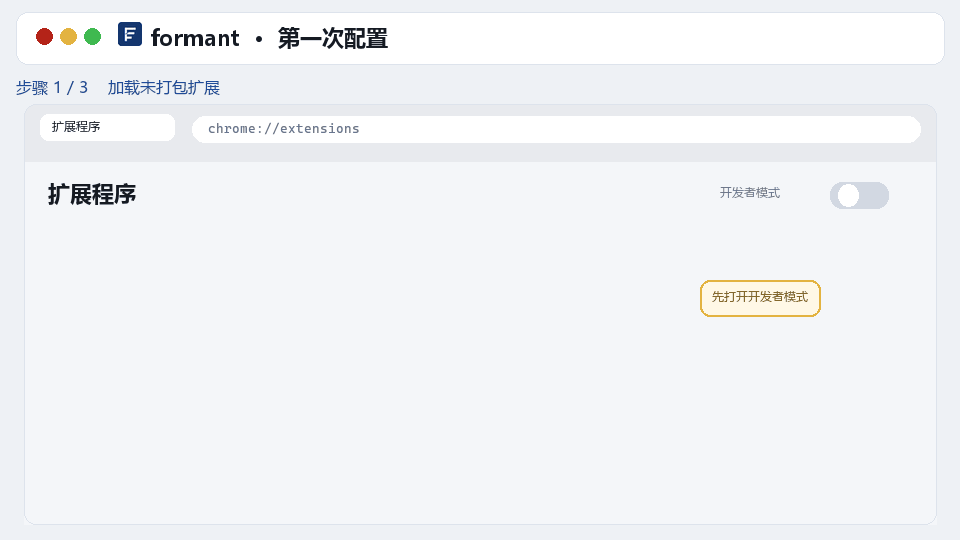

### 2. 日常使用

点工具栏图标输入文本，自动按词库打分走 Google / GPT；网页划词点「译」出浮动面板；新标签页同一行四卡（天气·万年历 / 假期·汇率 / 热点英语 / HLS）。

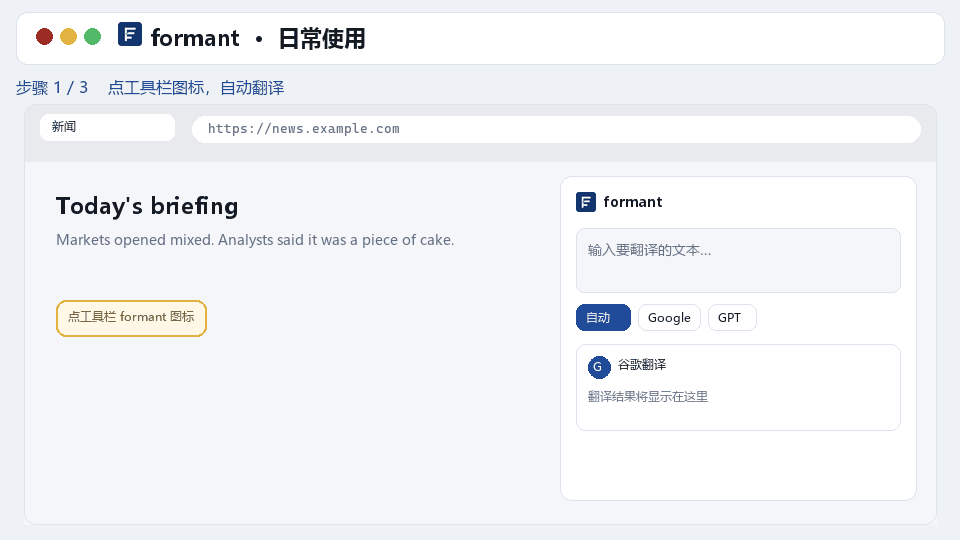

更细的加载步骤见下方「本地加载」。各功能示例 GIF 在「能力总览」对应小节。重新生成全部 GIF：

```bash
python scripts/render_readme_gifs.py
```

## 技术栈

| 层 | 技术 |
| --- | --- |
| 扩展 | Chrome Manifest V3、ES Module Service Worker |
| UI | 原生 HTML / CSS / JS（popup、newtab、option、Shadow DOM 划词面板） |
| 存储 | `chrome.storage.local`（formant 设置、翻译模式、自定义词库包、`formantGitzip`、`formantAutopagerize`、`formantProxy`、`formantGestures`、`formantXTranslate`、`formantImagePrompt`、`formantExchange`、`formantHlsSources`、`formantStudyWords`、`formantVocabFace`、`formantUserscripts`、`formantUsValues`）+ `chrome.storage.sync.options`（V2EX Plus 兼容设置） |
| 后端 | mono `https://www.oolaf.top`（或本地 `http://localhost:3101`） |

## 目录结构

```text
formant/                 主扩展（加载此目录为「未打包的扩展」）
  manifest.json
  background.js          SW：菜单、同步、翻译消息、词库预热
  popup.*                翻译 / 书签 / 站点数据 / 扩展管理 / oolafOffice 快捷条（工具箱入口开新标签页；齿轮进 option）
  newtab.*               覆盖页 New Tab
  newtab-tab.js          New Tab 标签记忆；Ctrl+Home 打开或切到 New Tab
  icons/newtab.*         New Tab 页签图标（房子，非扩展 F 标）
  favicon-cache.js       New Tab 快捷图标本机缓存（newtabCacheFavicons）
  newtab-vocab.js        New Tab 热点英语卡片（可翻到生词本）
  newtab-study.js        New Tab 生词本面与分页对话框
  study-words.js         生词本：只记英文单词，写入本机 storage
  newtab-widgets.js      天气 / 假期卡片
  newtab-calendar.js     New Tab 万年历（农历、节气、节日、放假区间）
  newtab-wx.js           New Tab 天气与万年历合成一张卡，右上角翻转，默认天气
  newtab-hx.js           New Tab 假期与汇率合成一张卡，右上角翻转
  newtab-hls.js          New Tab 第四卡 HLS 迷你播放（hover 切台 / 音量）
  newtab-exchange.js     New Tab 汇率卡片（本机币种、条数、排序）
  newtab-exchange-currencies.js  汇率下拉的全球法币清单
  newtab-exchange-countries.js   国家与货币对应，供汇率搜索
  option.html/js/css     通用扩展设置壳（#general / #features / #newtab / #v2ex / #gitzip / #autopagerize / #gestures / #proxy / #extensions / #lexicon / #translate / #x-translate / #image-prompt / #sync）
  option-features.js     功能开关面板
  option-gitzip.js       GitZip 公开模式设置面板
  option-autopagerize.js AutoPagerize 设置面板
  option-gestures.js     轻量鼠标手势：固定行为 CRUD + 画板绘制 + mono 同步
  option-gestures-pad.js 设置页手势画板（圈 / ✕ 两笔）
  option-proxy.js        轻量代理配置面板
  option-extensions.js   轻量扩展管理面板（启用/禁用/搜索）
  option-newtab.js       New Tab 外观、城市和主页同步面板
  option-v2ex.js         V2EX Plus 设置与三份管理列表
  extensions-manager.js  chrome.management 列表与启用禁用辅助
  proxy-config.js        代理 local 设置 schema（formantProxy）
  proxy-bridge.js        chrome.proxy.settings 应用与 storage 重入
  popup-proxy.js         popup 内代理快捷切换
  popup-panel.js         翻译独立窗口（切浏览器标签不关闭）
  popup-last-translate.js 上次 popup 原文/译文快照（再开不重新请求）
  site-data.js           当前页 Cookie / Storage 读取辅助
  image-prompt.js        识图：压缩图片并请求用户配置的视觉模型
  tools-image-prompt.js  识图面板（工具箱内左右布局：上传 / URL / 结果）
  tools-icons.js         工具箱列表与标题图标
  popup-tools.js         popup 顶栏「工具箱」图标：打开 tools.html（工具箱或识图任一开启即显示）
  tools.html/css         工具箱页壳（左侧列表 + 工作区；hash 路由 #qr #timestamp #json #diff #compare #image-base64 #codec #company #xiangqi #userscript #lighthouse #hls）
  tools-lighthouse.js    Lighthouse：右侧报告列表；新建测评 / 报告详情为二级 hash
  lighthouse/NOTICE      未复制官方 Lighthouse 扩展；测评走 PSI API
  tools-panels.css       工具箱各工具专属样式
  tools-page.js          工具箱路由、懒加载、按开关过滤、分组目录、组内拖拽排序（`formantToolsOrder`）；识图是列表里的一个面板
  tools-userscript.js    油猴：右侧脚本列表；新建 / 导入 / 搜索 / 编辑为二级 hash
  userscript/            油猴解析、匹配、存储、GM 注入（NOTICE：未复制 Tampermonkey）
  userscript-bridge.js   油猴 SW：注册 userScripts、Greasy Fork 搜索、GM 消息
  tools-dom.js           共用：`$`（querySelector）、`$$`（querySelectorAll）、复制 / 下载 / 粘贴 / 拖拽 / 脚本按需加载
  tools-timestamp.js     时间戳转换（秒/毫秒、时区、FILETIME、世界时间表）
  tools-image-base64.js  图片 ↔ Base64 / DataURI
  tools-codec.js         编码转换界面；tools-codec-lib.js 方法表；tools-md5.js 小型 MD5
  tools-qr.js            二维码生成；tools-qr-decode.js 识别（BarcodeDetector → zxing）
  tools-json.js          JSON 美化界面；tools-json-lib.js 解析 / 排序 / 大整数无损 / 嵌套展开
  tools-diff.js          对比界面；tools-diff-core.js 行 diff + JSON 结构 diff
  tools-compare.js       文件对比：文件夹 / 单文件 / 图片，拖拽或选择
  tools-compare-core.js  行 diff、目录配对、像素差异、差异跳转
  tools-compare-shell.js 对比页骨架与左右拖放
  tools-compare-history.js 最近对比（IndexedDB 文件句柄，不进配置 JSON）
  tools-company.js       企业背景查询面板；tools-company-lib.js 公开检索地址与最近记录
  tools-hls.js           工具箱 HLS：本机 m3u/txt 列表源，点播放可选 New Tab 卡片或播放页
  tools-xiangqi.js       中国象棋人机面板；规则 / 评估 / 搜索 / 记忆分文件，Worker 里算棋
  tools-xiangqi-board.js 实物风格棋盘 SVG 与走子动画
  tools-xiangqi-audio.js 本机 Web Audio 棋声（选/走/吃/将/胜负）
  tools-xiangqi-teach.js 教学模式着法讲解（本机规则，不走 mono）
  xiangqi/NOTICE         chinese-chess-ai（Apache-2.0）子力与位置表出处
  tools/vendor/          qrcode-generator（MIT）、zxing（Apache-2.0）与 NOTICE
  option-image-prompt.js 识图模型设置（formantImagePrompt）
  popup-site-data.js     popup 站点数据二级视图
  popup-extensions.js    popup 扩展管理二级视图
  popup-bookmarks.js     popup 书签二级视图
  gitzip-config.js       GitZip local 设置 schema（formantGitzip）
  gitzip-bridge.js       GitHub 菜单、内容脚本消息和按需注入适配
  gitzip/                GitZip 公开下载运行时与 MIT 归属/第三方 notices
  autopagerize-config.js AutoPagerize local 设置 schema（formantAutopagerize）
  autopagerize-bridge.js AutoPagerize siteinfo 存储、跨域 fetch、设置广播
  autopagerize/          AutoPagerize GPL/MIT 核心、XPath、Shadow DOM 状态条、内置 siteinfo
  gestures-config.js     鼠标手势 local 设置 schema（formantGestures，含 O/X 与预览字段）
  gestures-shape.js      圈 / ✕ / 方向序列识别
  gestures-preview.js    预览 PNG 生成与 S3 上传/删除
  gestures-sync.js       鼠标手势 GET/PUT /client/gestures
  gestures-bridge.js     手势动作（后退/前进/强刷/关标签/滚动）
  gestures/              右键划动 content（经典脚本 + Shadow DOM 轨迹）
  telegram-bridge.js     Telegram 受限媒体：http(s) 小图 chrome.downloads 兜底
  telegram/              Telegram Web 内容脚本（bootstrap / Shadow DOM / MAIN hook）
  x-translate-config.js  X 推文译文样式 schema（formantXTranslate）
  x-translate-bridge.js  时间线 Google PA 翻译消息（不走 mono）
  x-translate/           X/Twitter 时间线内容脚本（bootstrap / Shadow DOM）
  discord-bridge.js      Discord 当前页消息 Google PA 翻译（不走 mono）
  discord/               Discord 聊天手动翻译（右下角按钮）+ 输入框译英文图标（Google / GPT），均 Shadow DOM
  elitepvpers-bridge.js  elitepvpers 标题/楼层 Google PA 翻译消息（不走 mono）
  elitepvpers/           elitepvpers 帖子标题与回复内容脚本（bootstrap / Shadow DOM）
  github-issues-bridge.js GitHub issues 纯外文标题/评论 Google PA 翻译（不走 mono）
  github-issues/         GitHub issues 内容脚本（bootstrap / Shadow DOM）
  linuxdo/               linux.do 列表表格换皮（MIT 归属 linuxdo-lark-ui）
  hupu/                  bbs.hupu.com 顶栏 / 帖子 / 板块列表简洁版式（纯 CSS + 图片尺寸归一）
  freefq-bridge.js       freefq 帖子 TXT 经 chrome.downloads 导出
  freefq/                freefq.com 帖子详情解除禁复制 + 一键导出 TXT
  huavod-bridge.js       huavod disable-devtool 动态 DNR 拦截
  huavod/                huavod.com 控制台解锁（MAIN world + bootstrap）
  gemini-bridge.js       Gemini 成图由扩展后台拉取（避开内容脚本 CORS）
  gemini/                Gemini 生成图下载去水印（MAIN fetch hook + 右下角反混合）
  gmail/                 mail.google.com 顶栏显示当前邮箱，点击复制
  axure-bridge.js        本地 Axure HTML 框架间消息转发
  axure/                 file:// Axure 原型内容脚本（$ 选择器，无 jQuery）
  vue-bridge.js          按开关注册 Vue 页面 hook
  vue/                   DevTools「Vue」面板与页面 hook（$ 选择器，无 jQuery）
  hls-bridge.js          主框架 .m3u8 / .m3u / IPTV .txt 导航改开扩展播放页，地址栏关键字 m3u8
  hls/                   HLS 播放页（叠层控件、hls.js 1.6.10、.m3u / .txt 频道抽屉、倍速 / 旋转 / 存 MP4）
  hls/session-store.js   上次播放位置 + 一次性投放（formantHlsSession，不记播放中状态）
  hls/play-target.js     工具箱点播放：选 New Tab 卡片或独立播放页
  v2ex-options.js        V2EX Plus 2.1.3 兼容 storage schema
  v2ex-bridge.js         V2EX alarms、badge、sov2ex 菜单适配
  v2ex-plus/             GPLv3 V2EX Plus 衍生模块、COPYING、NOTICE、DNR 规则
  option-lexicon.js      词库管理面板
  deeplx-config.js       DeepLX API Key（本机，进钥匙导入导出）
  option-translate.js    翻译默认模式 / 目标语言 / DeepLX API Key
  option-x-translate.js  X 推文译文颜色 / 字号
  option-sync.js         mono 连接与书签同步
  option-keys.js         本机钥匙 JSON 导出 / 导入（同步、识图、Imgur、DeepLX；可粘贴 JSON）
  option-prefs.js        本机配置 JSON 导出 / 导入（功能开关、New Tab、V2EX、HLS 源等；可粘贴 JSON）
  option-scope.js        设置页展示当前 Client API Key 指纹与隔离说明
  features.js            功能开关（storage `formantFeatures`）
  newtab-entry.js        New Tab 入口（可按开关跳过）
  newtab-weather-bridge.js New Tab 天气 10 分钟 alarm 刷新
  translate-*.js         路由 / 打分 / API / 词库
  lexicon/               内置俚语源数据（en/zh/ja/ko/tr）
  lexicon-runtime.js     内置+自定义包合并与缓存
  image-save.js          图片转码另存为
  screenshot-bridge.js   滚动截屏：右键菜单、按需注入、逐屏采集
  screenshot-compose.js  截屏拼接与 PNG 下载
  screenshot/            按需注入的滚动 / Shadow DOM 进度条
  office-bridge.js       oolafOffice：右键菜单打开 Word / Excel / PPT
  popup-office.js        popup 主界面 oolafOffice 快捷条
  oolafoffice/           oolafOffice 套件（Quire / Ledger / Lectern，Apache-2.0，源自 VibeOffice）
  speak.js               TTS
  sync.js                书签同步与 mono 设置
  translate-content.js   划词浮动面板
  code-format.js         JS / CSS 美化（自研，不嵌入 prettier）
  code-highlight.js      JS / CSS 语法高亮
  code-viewer.js         JS / CSS 整页与 DevTools 查看器
  viewer.js              JSON 树查看器
bookmarks/               历史书签扩展片段（参考）
oolaf-web-json-prettify/ JSON 预ttify 片段（已并入 formant DevTools）
docs/                    README 示例 GIF（setup / usage 以及各功能一张）
scripts/                 Pillow 生成 README GIF（`python scripts/render_readme_gifs.py`）
DESIGN.md                视觉与 token
LOGS.md                  更改记录（文末追加）
README.md                本说明
```

## 本地加载

1. Chrome → `chrome://extensions` → 打开「开发者模式」
2. 「加载已解压的扩展程序」→ 选择本仓库里的 `formant` 目录
3. popup 齿轮或「扩展选项」打开 `option.html#sync`，填写：
   - **环境**：dev（`http://localhost:3101`）或 prod（`https://www.oolaf.top`）
   - **Client API Key**：mono Admin 签发的 `ock_live_…`
4. 保存时按需授权 mono 域名 host 权限

## Edge Add-ons 打包

Partner Center 只收 **zip 根目录就是扩展** 的包（`manifest.json` 必须在 zip 根上，不要套一层 `formant/`）。

```text
python pack-edge.py
```

产物在 `dist/`：

- `formant-<version>.zip` — 拖到「上传程序包」；已排除浏览器生成的 `_metadata/`、图标导出用的 `node_modules/`
- `store/logo-300.png` — 商店 Logo（1:1，建议 300×300）
- `store/icon-128.png` — 商店图标 128×128
- `store/screenshot-1280x800.png` — 宣传图（Edge / Chrome 均可用）；另有 `screenshot-640x400.png`
- `store/tile-440x280.png` / `store/tile-1400x560.png` — 可选宣传磁贴
- `store/LISTING.txt` — 名称 / 短描述 / 详细描述粘贴稿

清单短描述走 `_locales`（`default_locale` 为 `zh_CN`，另有 `en`），商店长描述、截图、隐私政策 URL 在 Partner Center 里另填，不打进 zip。截图须为 **640×480 或 1280×800**，最多 6 张。

CI（`python pack-edge.py --zip-only`）只打 zip，不生成商店图，也不需要 Pillow。

## GitHub Releases

`main` 每次推送（以及手动 Run workflow）会跑 `.github/workflows/release.yml`：按 `formant/manifest.json` 的 `version` 打 `formant-<version>.zip`，发布到 [Releases](https://github.com/dirkhe1051931999/formant/releases)。标签为 `v<version>`；同一版本再次推送会覆盖该 tag 上的 zip，不另开一条 Release。

## 能力总览

### 功能开关

各功能示例 GIF 见下方对应小节。

- 入口：`option.html#features`（扩展设置 → 功能）
- 存储：`chrome.storage.local.formantFeatures`
- **翻译**：总开关 + 弹窗 / 划词浮标 / 右键菜单
- **New Tab**：关闭后运行时跳转浏览器默认新标签页（manifest override 无法动态卸载）
- **图片另存为**：分别开关 PNG / JPG；都关则隐藏右键菜单组
- **滚动截屏**：默认开启。网页右键「formant 整页滚动截屏」或「formant 截取可见区域」拼成 PNG。关闭后隐藏该菜单。**未嵌入**第三方截屏扩展。
- **oolafOffice**：默认开启。popup 主界面快捷条 + 网页右键「formant oolafOffice」打开起始页 / Word / Excel / PPT（独立目录 `oolafoffice/`）。本机读写 `.docx` / `.doc` / `.xlsx` / `.xls` / `.pptx`，不走 mono。关闭后隐藏快捷条和该菜单。
- **V2EX Plus**：总开关关闭后停止签到、未读角标、页面增强、微博图 referer 规则与 sov2ex 菜单
- **GitZip**：总开关关闭后停用 GitHub 页面勾选、悬浮下载面板和 `formant GitZip` 右键菜单；其选择方式和主题仍保留在 `option.html#gitzip`
- **AutoPagerize**：总开关关闭后所有站点停止自动翻页；排除规则和状态条设置仍保留在 `option.html#autopagerize`
- **代理**：默认系统代理；支持 PAC；总开关关闭后 `chrome.proxy.settings.clear`，配置保留在 `option.html#proxy`
- **扩展管理**：总开关关闭后隐藏 popup 入口，`option.html#extensions` 只读提示，不主动改其它扩展状态；列表与启用/禁用仍走 `chrome.management`
- **站点数据**：总开关关闭后隐藏 popup 提取入口；开启后可对当前页读 Cookie / localStorage / sessionStorage
- **鼠标手势**：默认关闭。开启后网页右键划动执行固定行为（后退 / 前进 / 强刷 / 关标签 / 到顶 / 到底）；支持方向序列、宽松圆圈、两笔 ✕。映射在 `option.html#gestures` 增删改查，预览图按 Client API Key 存 S3。可同步 `GET/PUT /client/gestures`。**未嵌入** smartUp 源码。`edge://` / `chrome://` / 扩展商店无法注入。
- **Telegram 下载**：默认开启。仅在 Telegram Web 受限群组/私密频道为已能看到的图片与视频补保存按钮；**未嵌入**第三方下载器源码，也不走其云端站点。
- **X 推文翻译**：默认关闭。在设置里打开后，才在 `x.com` / `pro.x.com` / `twitter.com` 把可见的他人推文正文发给 Google 翻译；颜色和字号在 `option.html#x-translate`。**不走 mono**，不扣 Client API Key。**未嵌入** Post Translator 源码。
- **Discord 翻译**：默认开启。在 `discord.com` 聊天页右下角手动翻译当前频道已加载的这一页消息；上滚加载的更早历史不自动翻。颜色和字号共用 `option.html#x-translate`。**不走 mono**。刷新后记录清空。
- **elitepvpers 翻译**：默认关闭。在设置里打开后，才在 `www.elitepvpers.com` 把可见的他人帖子标题和楼层正文发给 Google 翻译（列表标题、帖子页标题、每楼标题与 `post_message`），不翻整页。颜色和字号共用 `option.html#x-translate`。**不走 mono**。
- **GitHub issues 翻译**：默认关闭。在设置里打开后，才在 `github.com` 把可见的他人 issues 标题和评论正文发给 Google 翻译成中文；纯外文才翻，中文或中外夹杂不翻。颜色和字号共用 `option.html#x-translate`。**不走 mono**。
- **linux.do 列表**：默认开启。把 `linux.do` 话题列表换成 formant 风格的文件表格；不改品牌/侧栏，不碰帖子详情。列表手法参考 [linuxdo-lark-ui](https://github.com/starwingcc/linuxdo-lark-ui)（MIT），**未拷贝**整份油猴脚本。
- **虎扑简洁版式**：默认开启。`bbs.hupu.com` 顶栏改白底两层导航（去掉 App 推广与游戏中心）、帖子页改单张白卡、回帖区去灰底粗框并收紧行距，帖子里的表情包统一高度、大图限制最大边。帖子详情可按板块列表翻上一帖 / 下一帖（直接打开详情也会自己去列表里找邻居）。只改样式与翻帖，**不走 mono、不新增权限**。
- **freefq 导出**：默认开启。在 `freefq.com` 帖子详情解除禁复制，并一键导出 UTF-8 TXT（正文已在 DOM，不走 mono）。**未嵌入**第三方解除复制/文章下载扩展。
- **huavod 控制台**：默认开启。拦截 `huavod.com` 的 `disable-devtool`，开 F12 不再被 `history.back` 踢走。**未嵌入**第三方 DevTools unlock 扩展。
- **Gemini 去水印**：默认开启。在 `gemini.google.com` / `business.gemini.google` 下载生成图时去掉右下角水印。只处理 googleusercontent 上的 `gg` / `rd` 成图。**未嵌入** Gemini 水印助手扩展包。
- **Gmail 邮箱**：默认开启。只在 `mail.google.com` 顶栏问号和设置左边显示当前登录邮箱，点击复制。其它域名不注入。
- **Axure 原型**：默认开启。用 `file://` 打开本地发布的 Axure HTML 时，在各框架之间转发页面已有的事件消息。没有事件节点的本地文件不挂监听。**未嵌入** Axure RP Extension。浏览器需允许扩展访问文件 URL。
- **Vue 组件**：默认开启。DevTools 增加「Vue」面板，Vue 3 和 Vue 2 都能看组件树、props / data，以及 Pinia 或 Vuex 的当前状态，并可高亮组件。当前标签检测到 Vue 时，工具栏 formant 图标右上角加绿色 V。**未嵌入** Vue.js devtools 的打包文件，也不改工具栏 popup。
- **HLS 播放**：默认开启。主框架打开路径以 `.m3u8`、`.m3u` 或 IPTV `.txt` 结尾的地址时，改在扩展内播放：直链用 hls.js，同名频道合并后在右侧抽屉选台，多线路失败自动切源。列表源在工具箱 `tools.html#hls` 配置（本机 `formantHlsSources`），点播放可选 New Tab 第四卡或独立播放页，也可随「同步」里的本机配置 JSON 带走。总开关仍在 `option.html#features`。普通文本 `.txt` 先看内容，不像频道表就不会劫持。控件叠在画面上（点画面播停、空闲藏底栏、双击全屏）。可调倍速和旋转，左右键快进快退，并可把当前流存成 MP4。地址栏关键字 `m3u8` 同样打开播放页。**未嵌入** Native HLS Playback / DPlayer，也不带 jQuery。
- **工具箱**：默认开启（`features.tools.enabled`）。入口是 popup 顶栏「工具箱」图标（替换了原来的「识图」图标，图标总数不变），点击在新标签页打开 `tools.html`，左侧列表含二维码、文件对比，再到企业查询、象棋、油猴、Lighthouse、HLS，以及识图。详见下文「工具箱（轻量）」。
- **油猴**：默认开启（`features.userscript.enabled`）。入口在工具箱「油猴」，右侧是已安装脚本列表，可导入 / 搜索 Greasy Fork / 管理。兼容常见 UserScript 头与 GM API。**未嵌入** Tampermonkey。新增权限 `userScripts`。
- **识图**：默认开启。入口收进 popup 顶栏「工具箱」页的左侧列表（也可只开识图、关掉工具箱，此时图标仍显示，列表只剩识图），识图是工具箱页内的左右布局面板（`#image-prompt`，和二维码同款），不再有独立页面，不在 popup 里做识别，也不注入网页、不加右键菜单。页内上传或填写图片 URL 后，用 `option.html#image-prompt` 里的 OpenAI 兼容视觉模型反解提示词。中文和英文各是一段按画面分区写的长提示（可见文字原样引用，圈选、打码、水印都算进画面），另附 JSON。配置存在 `chrome.storage.local.formantImagePrompt`（Base URL、API Key、Model），**不走 mono**，密钥不进仓库。换电脑时在 `option.html#sync` 导出本机钥匙 JSON。

### 智能翻译

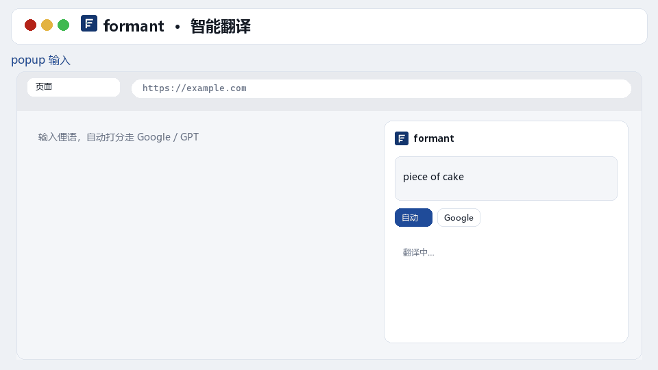

- **入口**：popup 输入框；划词图标 / 右键「用 formant 翻译」
- **模式**：自动 / Google / GPT / 全部（`translateMode` 持久化）
- **路由**：本地打分（脚本嗅探 + 词库命中 + 句式）；简单偏 Google，复杂并行 GPT
- **引擎**：
  - Google：浏览器直连 `translate-pa.googleapis.com`（gtx），失败走 mono `/client/newtab/translate/google`
  - GPT：mono `/client/newtab/translate/gpt`（ChatAnywhere）
  - DeepLX：浏览器直连 `https://api.deeplx.org/{apiKey}/translate`。API Key 在 `option.html#translate`，存在 `chrome.storage.local.formantDeeplx`，不进仓库、不经 mono。自动 / Google 下作 Google 失败兜底；「全部」并行
- **读音**：原文与译文喇叭；播放中动画
- **复制**：译文旁复制图标，写入剪贴板
- **独立窗口**：顶栏弹出按钮把同一份 `popup.html` 开成 `type=popup` 小窗；切浏览器标签不会关。工具栏 `default_popup` 失焦必关，这是 Chrome 限制，不改 `action.default_popup`、不新增权限
- **上次原文**：仅在 popup 开着时切过浏览器标签，下次打开才还原上次原文和译文（不重新请求）。自己点外面 / 再点图标关掉再开，输入框是空的。改字、改模式或改目标语言才再请求；关浏览器后快照清空

### X 推文翻译（轻量）

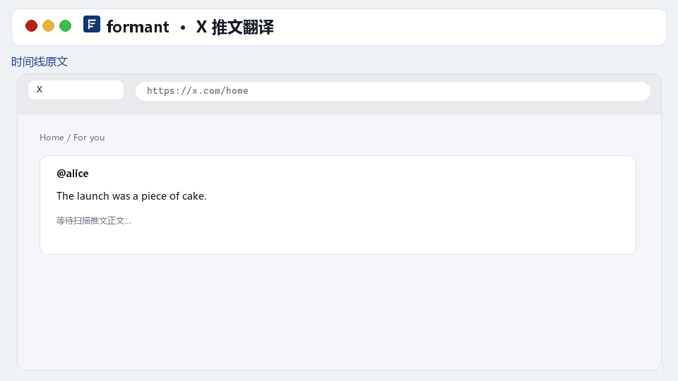

- 入口：`option.html#features` 总开关（`features.xTranslate.enabled`，**默认关闭**）+ `option.html#x-translate` 颜色 / 色号 / 字号。不另开独立 popup / options 页。打开后，可见的他人推文正文自动发给 `translate-pa.googleapis.com`，只用于当页译文；关闭后立即停止。
- **能力**：在 X/Twitter 时间线为可见推文正文（`div[data-testid='tweetText']`）串行补译文。目标语言共用「翻译」面板的 `translateTarget`。译文与原文相同时不展示。
- **样式**：默认颜色 `#8c8c8c`、字号 `14px`；Shadow DOM 挂在推文正文旁。改颜色/字号后已插入的译文立刻变。
- **翻译路径**：只走浏览器直连 `translate-pa.googleapis.com`（gtx）。失败静默跳过该条，稍后重试。**禁止**走 mono / GPT / DeepLX，避免花 Client API Key。popup / 划词的 Google 仍可走原有 mono 兜底。
- **边界**：formant 自研，不整包嵌入第三方推文翻译扩展。不改 `action.default_popup`，不新增权限。

#### X 推文翻译冒烟清单

1. 重载 formant。新安装时开关是关的，时间线没有译文、也没有发往 Google 的翻译请求。在 `option.html#features` 打开「启用 X 推文翻译」后刷新 `https://x.com/`：可见外文推文下方应出现灰色小字译文。popup / 划词翻译不受影响。
2. `option.html#x-translate` 改颜色或字号：已显示的译文立即换样式，不必刷新。
3. 关闭 `features.xTranslate.enabled` 后刷新 X：译文消失。
4. 未填 Client API Key 时时间线仍应能出译文；划词/popup 的 Google 失败兜底仍可走 mono。

### Discord 聊天翻译（轻量）

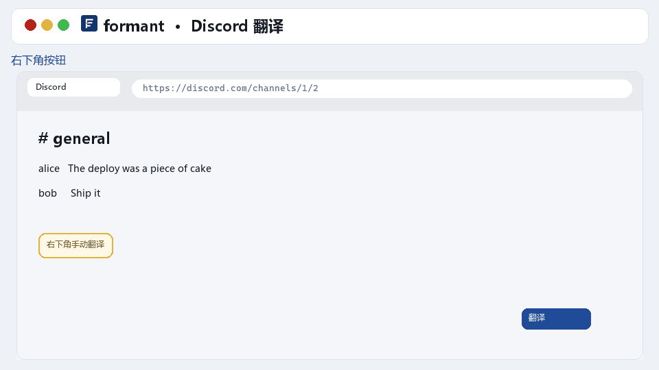

- 入口：仅 `option.html#features` 总开关（`features.discord.enabled`，**默认开启**）。不另开独立 popup / options 页。
- **能力**：在 `discord.com` / `ptb.discord.com` / `canary.discord.com` 的 `/channels/` 页面右下角（输入框上方）显示「翻译」。点击后只翻译当前聊天列表里已经渲染的消息正文（`[data-list-id="chat-messages"]` 内的 `[id^="message-content-"]`）。频道由地址 `/channels/{服务器或 @me}/{频道}` 识别：换频道是新窗口，清空本页记录后整页重翻；同一频道里消息 id 列表变了（往上滚加载更早历史，或底部来了新消息）是新页，只补还没翻过的消息。同一页再点不会重复请求。不点按钮不会翻译新加载的页。刷新页面后内存清空。
- **样式**：译文 Shadow DOM 挂在消息正文后面。颜色和字号复用 `option.html#x-translate`（默认 `#8c8c8c` / `14px`）。按钮本身是固定位置的 Shadow DOM。
- **翻译路径（聊天消息）**：只走浏览器直连 `translate-pa.googleapis.com`（gtx），和 X 推文同一条引擎；长消息按约 1200 字分段再拼回。串行，同时只翻 1 条。译文与原文相同时不展示。失败的条目按钮会标出数量，再点一次会重试。**禁止**走 mono / GPT / DeepLX。
- **输入框翻译**：输入框（Slate 编辑器）右侧、Discord 自带按钮左边有一个翻译图标（Shadow DOM，`input.js`；尺寸、颜色、悬停底色沿用 Discord 的 `--interactive-*` / `--background-modifier-hover` 变量，与相邻礼物 / GIF 图标一致）。点图标弹出菜单选「Google」（translate-pa，同 X）或「GPT」（`POST /client/newtab/translate/gpt`，经 mono，消耗 Client API Key），把输入框内容译成**英文**，译文**直接写入输入框**，原文以一条细栏（`input-strip.js`，Shadow DOM，无弹窗）贴在输入框正上方，栏内「撤回」把原文写回、「×」关闭。翻译中同一条细栏显示转圈和「正在用 Google/GPT 翻译…」；失败（含超时、未填 Client Key 等）显示红色错误原因，8 秒后消失或点「×」关闭；「输入框是空的」等提示也走这里。输入框内容被改动、发送或切频道时细栏自动消失，Esc 也可关闭。写入方式：（全选后派发粘贴事件，让 Slate 自己写入；禁止 `execCommand` 直接改 DOM，否则 Slate 模型失同步、退格删不掉）。只在用户点选引擎时请求；请求期间输入有变化则放弃替换。最近一次引擎存在 `chrome.storage.local.formantDiscordInput`（不含密钥，不同步）。消息 `FORMANT_DISCORD_INPUT_TRANSLATE`。聊天消息翻译路径不受影响。
- **边界**：formant 自研。不改 `action.default_popup`，不新增权限，不把译文写入 `chrome.storage`。

#### Discord 翻译冒烟清单

1. 重载 formant（默认开启）；打开 `https://discord.com/channels` 里的一个频道：右下角应有「翻译」。未点击时消息下没有译文。
2. 点「翻译」：当前已加载的消息下出现灰色小字译文。按钮先显示「新窗口」，完成后回到「翻译」。
3. 往上滚动加载更早消息：新出来的历史没有译文。再点一次，按钮显示「新页」，只补这些还没翻过的消息。
4. 换到另一个频道再点：按钮显示「新窗口」，只翻这个频道当前页。
5. 刷新页面：译文和记录消失，需要再点一次。
6. `option.html#x-translate` 改颜色或字号：已显示的 Discord 译文立即换样式。
7. 关闭 `features.discord.enabled`：按钮、输入框图标和译文马上消失。X 推文翻译开关互不影响。
8. 在输入框打一句中文，点输入框右侧的翻译图标 → 选 Google：输入框直接变为英文且不会发送，输入框正上方出现一条「原文」细栏；点「撤回」恢复原文，退格可正常删除。再试 GPT（需已填 Client API Key）。输入框为空时提示「输入框是空的」。多行内容换行保留。

### elitepvpers 帖子翻译（轻量）

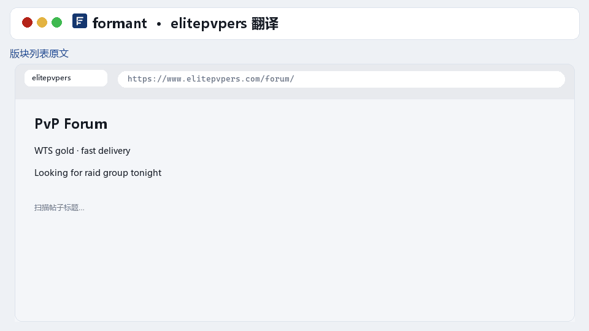

- 入口：仅 `option.html#features` 总开关（`features.elitepvpers.enabled`，**默认关闭**）。不另开独立 popup / options 页。打开后，可见的他人标题和楼层正文自动发给 `translate-pa.googleapis.com`，只用于当页译文；关闭后立即停止。
- **能力**：在 `elitepvpers.com` / `www.elitepvpers.com` 为可见的帖子标题和楼层正文串行补译文。列表用 `a[id^="thread_title_"]`；帖子页标题用 `h1[itemprop="headline"]`（没有时用较短的 `div.cwhead`）；每楼标题用 `td[id^="td_post_"] > div.smallfont`；正文用 `div[id^="post_message_"]`。导航、用户名、签名不翻。目标语言共用「翻译」面板的 `translateTarget`。译文与原文相同时不展示。
- **样式**：Shadow DOM 挂在对应节点后面。颜色和字号复用 `option.html#x-translate`（默认 `#8c8c8c` / `14px`）。
- **翻译路径**：只走浏览器直连 `translate-pa.googleapis.com`（gtx），长楼按约 1200 字分段再拼回。失败静默跳过该条，稍后重试。**禁止**走 mono / GPT / DeepLX。
- **边界**：formant 自研。不改 `action.default_popup`，不新增权限。

#### elitepvpers 翻译冒烟清单

1. 重载 formant。新安装时开关是关的，列表没有译文。在 `option.html#features` 打开「启用 elitepvpers 帖子翻译」后刷新 `https://www.elitepvpers.com/forum/`：可见外文帖子标题下应出现灰色小字译文。导航和用户名保持原文。
2. 打开一帖：帖子标题和每一楼正文下应有译文；签名不翻译。
3. `option.html#x-translate` 改颜色或字号：已显示的 elitepvpers 译文立即换样式。
4. 关闭 `features.elitepvpers.enabled` 后刷新页面：译文消失。X 推文翻译开关互不影响。

### GitHub issues 翻译（轻量）

- 入口：仅 `option.html#features` 总开关（`features.githubIssues.enabled`，**默认关闭**）。不另开独立 popup / options 页。打开后，可见的他人纯外文标题和评论自动发给 `translate-pa.googleapis.com` 译成中文，只用于当页译文；关闭后立即停止。
- **能力**：在 `github.com` 的 issues 列表、详情页为可见的纯外文标题和评论正文串行补**中文**译文。新 UI：列表 `[data-testid="issue-listitem-title-link"]`；详情标题 `[data-testid="issue-title"]`；正文 `[data-testid="markdown-body"]`（只取 `issue-body-viewer` 与 `comment-viewer-outer-box-*`）。经典 UI：`.js-issue-title` / `a[id^="issue_"]` / `.js-comment-body`。导航、用户名、标签、代码块不翻。含汉字的中文或中外夹杂（如「[Feature] 支持只读模式」）不翻。
- **样式**：Shadow DOM 挂在对应节点后面。颜色和字号复用 `option.html#x-translate`（默认 `#8c8c8c` / `14px`）。
- **翻译路径**：只走浏览器直连 `translate-pa.googleapis.com`（gtx），固定 `zh-CN`，长评论按约 1200 字分段再拼回。失败静默跳过该条，稍后重试。**禁止**走 mono / GPT / DeepLX。
- **边界**：formant 自研。不改 `action.default_popup`，不新增权限，不碰 GitZip 菜单。

#### GitHub issues 翻译冒烟清单

1. 重载 formant。新安装时开关是关的，issues 没有译文。在 `option.html#features` 打开「启用 GitHub issues 翻译」后刷新 `https://github.com/tcchen2026/VibeOffice/issues`：纯英文标题（如 #25）下应出现灰色中文译文；「工作表标签卡颜色」等中文、以及「[Feature Request] 支持只读模式」等中外夹杂标题保持原文。
2. 打开 `https://github.com/tcchen2026/VibeOffice/issues/25`：标题和正文下应有中文译文；用户名和侧栏不翻。
3. `option.html#x-translate` 改颜色或字号：已显示的 GitHub issues 译文立即换样式。
4. 关闭 `features.githubIssues.enabled` 后刷新页面：译文消失。X 推文翻译 / GitZip 开关互不影响。

### linux.do 列表（轻量）

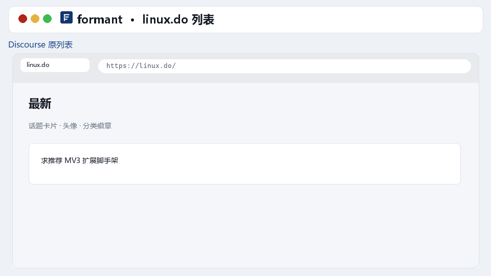

- 入口：仅 `option.html#features` 总开关（`features.linuxdo.enabled`，**默认开启**）。不另开独立 popup / options 页。
- **能力**：在 `https://linux.do/` 的最新 / 分类等列表页，把 Discourse `.topic-list` 换成飞书式文件表格（标题 / 所有者 / 回复 / 浏览 / 最近活跃），分类 Tab 收成底边指示条；未读/新帖左侧 accent 竖条 + 加粗标题；底栏默认只留分类、tag 悬停再出。列表与顶栏/全页搜索结果里的 `/t/` 帖子链接左键用 `window.open(..., "_blank")` 新标签打开（Ctrl/Cmd/中键仍交浏览器；分类/用户等非帖子链不动）；搜索面板字号/hover 与列表对齐。详情页 `/t/` 做阅读向精简：去掉统计条、楼层轴、标题下分类/tag、标语条、底部分享/书签/举报/通知、相关话题、表情统计与附议/火箭小条；话题回复钮一进帖就常显在右下角（accent pill，点它触发站点原回复；打开回复框时隐藏），不需要滑到页底；楼主帖左侧 accent 竖条，引用/代码块统一 fill 底。列表与详情都隐藏欢迎/公告横幅、顶栏 logo 与汉堡、语言切换、类别/标签下拉、侧栏底聊天与主题/工具图标。
- **样式**：共用前缀 `html.formant-linuxdo`；列表表格在 `html.formant-linuxdo-list`，详情精简在 `html.formant-linuxdo-topic`，搜索在 `search.css`。配色用 formant token（`#1f4b99` / `#151a22` / `#667084`）。深色跟随站点自身颜色模式。
- **边界**：不拆 Ember、不拉话题 JSON、不改 favicon、不做楼中楼或列表预览。列表页会藏掉顶栏 logo/语言、公告、类别/标签和侧栏底工具，导航分区不重排。AutoPagerize 对 `linux.do` 硬排除。若已装 linuxdo-lark-ui 油猴会叠皮，关掉其一即可。
- **许可**：列表手法派生自 [linuxdo-lark-ui](https://github.com/starwingcc/linuxdo-lark-ui) MIT；归属见 [`formant/linuxdo/LICENSE`](formant/linuxdo/LICENSE) 与 [`formant/linuxdo/NOTICE`](formant/linuxdo/NOTICE)。

#### linux.do 列表冒烟清单

1. 重载 formant（默认开启）；打开 `https://linux.do/`：列表应为表格；公告、顶栏 logo/汉堡/语言、类别/标签、侧栏底聊天与工具条应隐藏；搜索和头像仍在。
2. 左键点列表帖子标题（或回复/活跃等 `/t/` 链接）：应新标签打开详情，原列表页不跳转；Ctrl/Cmd+点击仍可新标签。未读行应有左侧蓝条与加粗标题；悬停行才出现 tag。
3. 顶栏搜索（或 `/search`）点绿色帖子标题：同样新标签打开，搜索面板所在页不跳转；搜索标题/摘要风格应接近列表。
4. 点进 `/t/...`：详情继续藏上述控件；楼主帖左侧蓝条；引用块与代码块为 fill 底；无统计条、楼层轴、相关话题、底部分享/通知、标题 tag、表情/附议小条；右下角立刻有「回复」（不必滑到页底）；点开后回复框弹出、该钮隐藏。后退回列表皮肤恢复且无重复列名。
5. 关闭 `features.linuxdo.enabled` 后刷新：恢复原列表；帖子恢复同页 SPA 跳转。
6. AutoPagerize 开启时 linux.do 不叠翻页。

### 虎扑简洁版式（轻量）

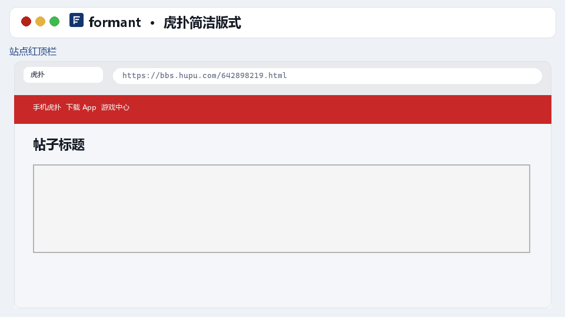

- 入口：仅 `option.html#features` 总开关（`features.hupu.enabled`，**默认开启**，不同步到 mono）。不另开 options 页，不新增权限。
- **能力**：内容脚本匹配 `*://bbs.hupu.com/*`（`all_frames: false`，`document_start`）。顶栏换成白底两层导航，藏「手机虎扑 / 下载 App / 加入虎扑」与游戏中心，logo 转深色，当前栏目用主色下划线，登录/注册按钮用主色。帖子页 `/{id}.html`：主帖与回帖合为一张白卡；「这些回帖亮了 / 全部回帖」去灰底粗框，标题竖条换主色；回帖头像 32px、行距收紧；「点灭 / 只看此人 / 举报」与引用里的「只看此人」悬停才显示，楼层号常驻；引用块改左侧浅线 + 浅底；右侧最热 / 最新帖与回复框改成圆角卡片，吸顶标题条与回复按钮用主色。标题下和底部固定条提供「上一帖 / 下一帖」，顺序跟板块列表一致。板块列表页只把关注 / 发帖按钮、Tab 下划线与分页换成主色。
- **上下帖**：列表页把当前页 tid 写入 `chrome.storage.local.formantHupuNav`（按板块 + 排序，跨标签可读）。详情页先读这份缓存；没有或找不到当前 tid 时，用面包屑里的板块 slug 同域拉取 `/{board}`、`/{board}-2`…（最多 10 页）直到定位到当前帖。因此新标签打开、或直接粘详情 URL，都能算出邻居，不依赖 referrer。排序默认「最新回复」；若缓存来自「最新发布 / 24小时榜」则沿用。找不到则「下一帖」变成回板块。不新增权限。
- **表情 / 图片尺寸**：`main.js` 按图片真实尺寸给帖子正文与引用里的 `` 打标——最长边 < 64 当行内表情（20px 高）；最长边 ≤ 480 且长宽比 ≤ 2 当表情包（统一 88px 高，引用里 56px）；其余当大图（回帖最大 360px，主帖 520px，引用 160px）。图片懒加载，靠捕获阶段的 `load` 事件补标。
- **样式**：默认开启的规则挂在 `html:not(.formant-hupu-off)`，manifest CSS 在 `document_start` 注入后立刻生效，不等 storage、不闪站点红顶栏。帖子页规则另要 `html.formant-hupu-thread`，由 `bootstrap.js` 在第一行按路径同步挂上。关闭开关时给 `html` 加 `formant-hupu-off` 并去掉帖子 class。站点 CSS Modules 带 hash，一律用 `[class*="前缀__"]` 匹配。文件：`base.css`（顶栏 / 页脚）、`thread.css`（主帖 / 分页 / 面包屑）、`replies.css`（回帖 / 引用 / 图片）、`aside.css`（侧栏 / 回复框 / 吸顶条）、`list.css`（板块列表）。
- **边界**：只改样式、图片尺寸与上下帖导航，不改帖子内容、不碰登录发帖逻辑；登录后的顶栏下拉未逐项适配。超过最近约 500 帖（10 页）的老帖可能算不出邻居。若已装同类虎扑美化脚本会叠皮，关掉其一即可。

#### 虎扑简洁版式冒烟清单

1. 重载 formant（默认开启）；打开 `https://bbs.hupu.com/642898219.html`：不应先闪红顶栏 / 灰底再换皮；顶栏为白底两层，无 App 推广；帖子为一张白卡，回帖行距紧凑。
2. 回帖里的表情包（小熊猫、乌萨奇等）应同高；大图不超过 360px；`[捂脸]` 等小表情和文字一样大。
3. 悬停某条回帖：才出现「点灭 / 只看此人 / 举报」；楼层号一直在。
4. 向下滚动：吸顶标题条的「只看楼主 / 回复」为蓝色。
5. 打开 `https://bbs.hupu.com/mavericks`：顶栏同上，关注 / 发帖与 Tab 下划线为蓝色。
6. 新标签打开列表里某帖：标题下和底部应有上一帖 / 下一帖，点下一帖应到列表里的下一条，不必回列表。
7. 地址栏直接打开 `https://bbs.hupu.com/642898219.html`（不经过列表）：仍应出现上一帖 / 下一帖，不能是空的。
8. 关闭 `features.hupu.enabled` 后刷新（或直接关，无需刷新）：恢复站点原样，图片 class 清空，上下帖条消失。

### freefq 导出（轻量）

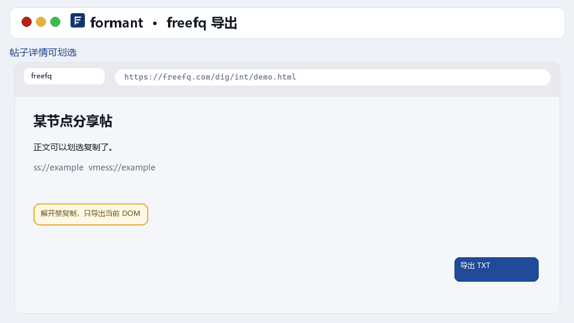

- 入口：仅 `option.html#features` 总开关（`features.freefq.enabled`，**默认开启**）。不另开独立 popup / options 页。
- **能力**：在 `freefq.com` / `www.freefq.com` 帖子详情（含 `/m/` 移动端）解除禁划选/复制/右键：CSS `user-select`、清掉 `onselectstart` / `oncontextmenu` / `onmousedown` 等钩子，并用捕获阶段拦住站点页尾再次绑定；右下角 Shadow DOM「导出 TXT」从已渲染 DOM 取正文，经 `chrome.downloads` 保存 UTF-8（带 BOM）TXT。文件含标题、元信息、URL 与正文。
- **正文选择器**：PC 优先 `td#text`；移动端 `div.wz`；再回退用户提供的文章区 XPath。标题读 `.title_info h1` / `h3.bt`。
- **边界**：formant 自研，不整包嵌入第三方解除复制或文章下载扩展。只读当前页 DOM，不爬站、不走 mono、不新增权限。禁止改 `action.default_popup`，禁止 `contextMenus.removeAll()`。

#### freefq 导出冒烟清单

1. 重载 formant（默认开启）；打开例如 `https://freefq.com/dig/int/2026/08/10/renkou.html`：应能划选正文；右下角有「导出 TXT」。
2. 点导出：下载以标题命名的 `.txt`，内容含全文（非截断摘要）；用记事本打开中文正常。
3. 关闭 `features.freefq.enabled` 后刷新：按钮消失，站点原禁复制恢复。

### huavod 控制台解锁（轻量）

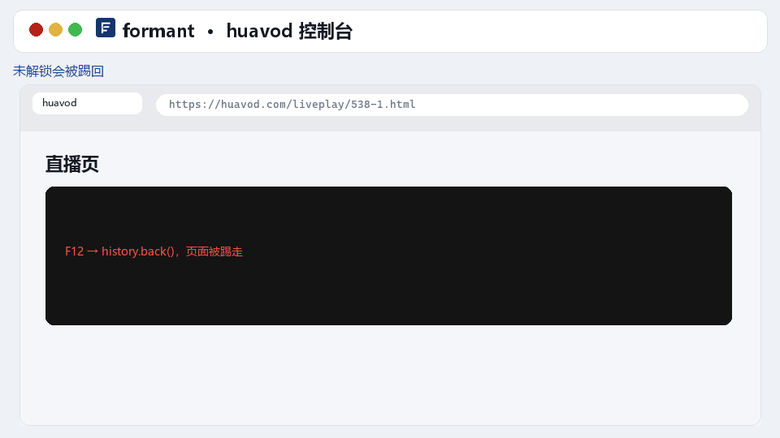

- 入口：仅 `option.html#features` 总开关（`features.huavod.enabled`，**默认开启**）。不另开独立 popup / options 页。
- **能力**：`huavod.com` / `www.huavod.com` 直播等页加载了 CDN `disable-devtool`（`disable-devtool-auto`），开 DevTools 会 `history.back()` 或清页。formant 用动态 DNR 拦该 script，并在 MAIN world `document_start` 挂起 `DisableDevtool.isSuspend`；无用户手势时吞掉 `history.back` / `history.go(-n)`。浏览器后退按钮（有用户手势）仍可用。
- **边界**：formant 自研，不整包嵌入第三方 unlock 扩展。不新增权限（复用已有 `declarativeNetRequest`）。禁止改 `action.default_popup`，禁止 `contextMenus.removeAll()`。

#### huavod 冒烟清单

1. 重载 formant（默认开启）；打开例如 `https://huavod.com/liveplay/538-1.html`，按 F12：页面应留在原址，控制台可用。
2. Network 中不应再成功加载 `disable-devtool` 脚本（或已挂起无效）。
3. 关闭 `features.huavod.enabled` 后硬刷新：再开 F12 应恢复被踢回上一页的行为。

### Gemini 去水印（轻量）

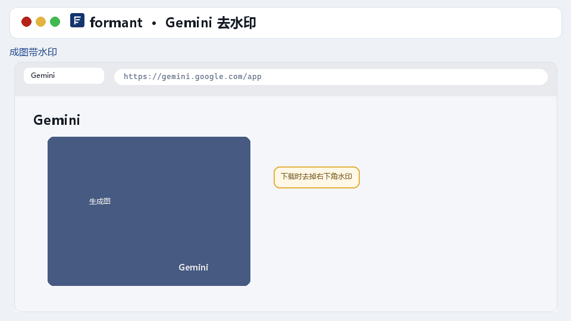

- 入口：仅 `option.html#features` 总开关（`features.gemini.enabled`，**默认开启**）。不另开独立 popup / options 页。
- **能力**：`gemini.google.com` / `business.gemini.google` 上，页面 `fetch` 拉取的 Gemini 成图（`*.googleusercontent.com`，路径首段为 `gg` / `gg-*` / `rd-*`）会先升到原图尺寸（`=s0`），再按右下角蒙版做白色水印反混合，以 PNG 交回下载。已知输出尺寸用对应 48 或 96 蒙版；更大未知尺寸用 96，其余用 48。
- **边界**：formant 自研钩子，蒙版与反混合来自 GargantuaX gemini-watermark-remover 1.0.2（MIT），见 `gemini/NOTICE`。不整包嵌入该扩展。不新增权限（已有 `https://*/*`）。关闭开关后下一次下载恢复原图。不改 `action.default_popup`，禁止 `contextMenus.removeAll()`。

#### Gemini 去水印冒烟清单

1. 重载 formant（默认开启）；打开 `option.html#features`，应看到「Gemini 去水印」说明和「启用 Gemini 下载去水印」，默认勾选。概览里的已启用列表含「Gemini 去水印」。
2. 打开 `https://gemini.google.com/`，下载一张生成图：保存下来的图右下角不应再有 Gemini 水印。
3. 关掉 `features.gemini.enabled` 后再下载：图恢复带水印。其它网站的图片下载不受影响。

### Gmail 邮箱（轻量）

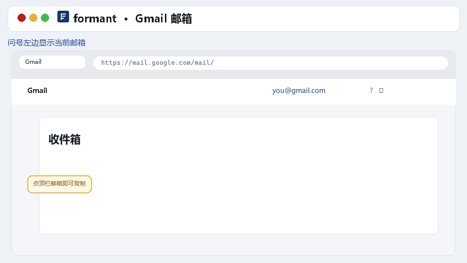

- 入口：仅 `option.html#features` 总开关（`features.gmail.enabled`，**默认开启**）。不另开独立 popup / options 页。
- **能力**：只在 `https://mail.google.com/*` 顶栏，把当前账号邮箱放进问号（支持）和齿轮（设置）左边的空白。优先读账号按钮上的邮箱，读不到再用页面里的 `GLOBALS`。文字可选中，点击写入剪贴板。
- **边界**：不注入其它 Google 域名。不新增权限。关闭开关后卸掉这块文字。不改 `action.default_popup`，禁止 `contextMenus.removeAll()`。

#### Gmail 邮箱冒烟清单

1. 重载 formant（默认开启）；打开 `option.html#features`，应看到「Gmail 邮箱」说明和「启用 Gmail 当前邮箱」，默认勾选。概览里的已启用列表含「Gmail 邮箱」。
2. 打开 `https://mail.google.com/`，顶栏问号左边应出现当前邮箱。点击后可贴到别处。
3. 关掉 `features.gmail.enabled`：邮箱文字消失。其它网站顶栏不受影响。

### Axure 原型（轻量）

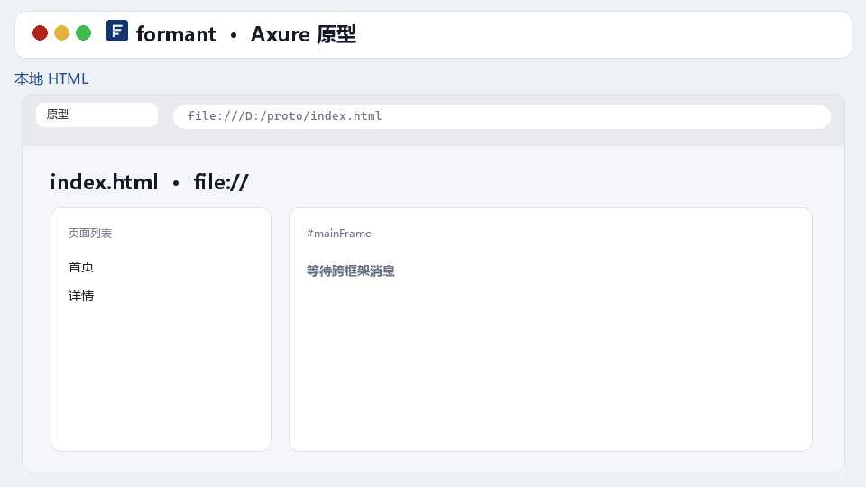

- 入口：仅 `option.html#features` 总开关（`features.axure.enabled`，**默认开启**）。不另开独立 popup / options 页。
- **能力**：内容脚本匹配 `file://*`，且所有框架都会注入。页面里同时有 `axureEventReceiverDiv` 和 `axureEventSenderDiv` 时，把 `axureMessageSenderEvent` 经 service worker 送到同一标签的各框架，再写成接收节点上的 `axureMessageReceiverEvent`。带 `#mainFrame` 的页面给 `body` 标 `pluginDetected`。选择器是 `$`（`querySelector`），不用 jQuery。
- **边界**：不拷贝官方扩展的图标、公钥或扩展 ID。不新增权限。Edge / Chrome 仍要在扩展详情打开「允许访问文件 URL」，否则 `file://` 页面不会注入。关闭开关后停监听并去掉 `pluginDetected`。不改 `action.default_popup`，禁止 `contextMenus.removeAll()`。若同时装着 Axure RP Extension，两条桥会各发一次，关掉其一。

#### Axure 原型冒烟清单

1. 重载 formant（默认开启）；打开 `option.html#features`，应看到「Axure 原型」说明和「启用 Axure 本地原型」，默认勾选。概览里的已启用列表含「Axure 原型」。
2. 扩展详情打开「允许访问文件 URL」。用 `file://` 打开一份本地发布的 Axure `index.html`：原型里的页面跳转和交互应能跨框架工作。首页 `body` 有 `pluginDetected="true"`。
3. 关掉 `features.axure.enabled` 后刷新该本地页：`pluginDetected` 消失，跨框架交互不再经 formant 转发。
4. 打开一份普通本地 HTML（没有 Axure 事件节点）：页面行为不变。

### Vue 组件（轻量）

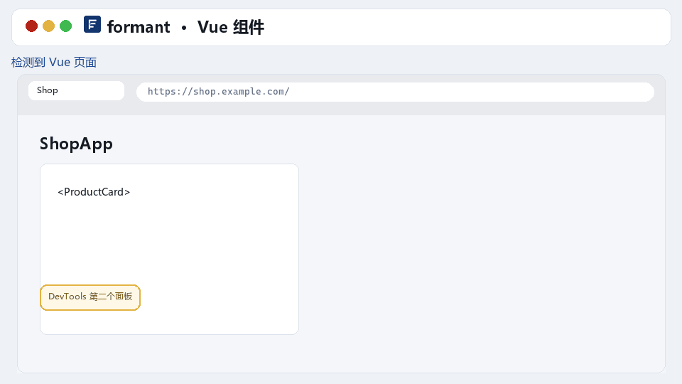

- 入口：`option.html#features` 总开关（`features.vue.enabled`，**默认开启**）。检查界面在现有 DevTools 里，面板名「Vue」，与原来的 formant 请求面板并列。不另开 popup。
- **能力**：页面加载前注入 `__VUE_DEVTOOLS_GLOBAL_HOOK__`。Vue 3 用 `app:init`，Vue 2（legacy）用 `init` / `vuex:init`，并扫描 `__vue__`。点一个组件可看 props、setup 或 data、attrs，并在页面上框出对应元素。Pinia 和 Vuex 都能看当前状态，两边同时存在时各有一个按钮。检测到 Vue 的标签，工具栏图标右上角加一枚绿色 V，离开该页后恢复。面板脚本用 `$`（`querySelector`），没有 jQuery。
- **边界**：不拷贝 Vue.js devtools 6.6.4 的 `build/`、popup 或图标。不新增权限，不改 `action.default_popup`。高亮在 Shadow DOM 里。只检查 DevTools 打开的顶层页面，iframe 里的应用不会列出来。生产构建若没打开 Vue 的 devtools 标志，官方扩展同样看不到。关闭开关后，已打开的页面停止检查，之后新开的页面不再注入。刚打开开关时需要刷新页面。若同时装着 Vue.js devtools，关掉其一。

#### Vue 组件冒烟清单

1. 重载 formant（默认开启）；打开 `option.html#features`，应看到「Vue 组件」说明和「启用 Vue 组件检查」，默认勾选。概览里的已启用列表含「Vue 组件」。工具栏 popup 仍是 formant 自己的。
2. 打开一个开发模式的 Vue 3 或 Vue 2 页面并刷新。工具栏 formant 图标右上角应出现绿色 V。DevTools 的「Vue」面板能看到组件树。点一个组件，右侧出现数据，页面上有蓝色高亮。
3. Vue 3 + Pinia、Vue 3 + Vuex、Vue 2 + Vuex 都应能点开对应状态。离开这个页面后，图标右上角的 V 消失。
4. 关掉 `features.vue.enabled`：面板提示已关闭，高亮消失，图标恢复。再打开一个新页面，不应再注入 hook。

### HLS 播放（轻量）

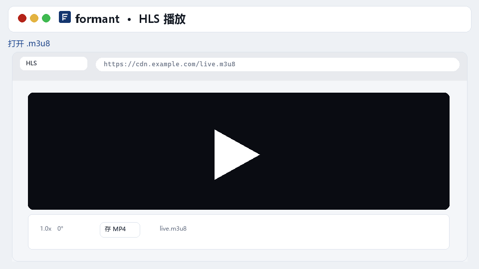

- 入口：`option.html#features` 总开关（`features.hls.enabled`，**默认开启**）；列表源在工具箱 `tools.html#hls`（休闲分组）。点「播放」弹出位置菜单：New Tab 第四卡（迷你播放）或独立播放页。地址栏关键字 `m3u8` 输入完整地址后，在当前标签打开播放页。
- **能力**：主框架导航到 pathname 以 `.m3u8`、`.m3u` 或 `.txt` 结尾的 http(s) 地址（忽略 query / hash）时，`tabs.update` 到 `hls/player.html#` 编码后的原 URL。`.txt` 会先拉文本嗅探：带 `#genre#` 或至少两行 `名称,http` 才当频道表，否则不劫持。`.m3u8` 直接用 hls.js 播放。`.m3u` / IPTV `.txt` 先拉文本：带 `#EXT-X-TARGETDURATION` / `#EXT-X-STREAM-INF` 的仍当 HLS；否则按 EXTINF 或 TVBox `名称,地址` / `#genre#` 解析。同名频道（`CCTV-1` / `cctv1`）合并成一条，多线路失败自动切下一条；抽屉里显示线路数。可看当前列表地址和正在播的地址，行旁复制图标一键复制，或点「源码」看原始文本。工具箱 `tools.html#hls` 可添加 / 删除已保存的 m3u、txt（`chrome.storage.local.formantHlsSources`，最多 20 条，不同步 mono），点「播放」可选送到 New Tab 第四卡或打开独立播放页；上次选择会标出来。New Tab 卡片只在 hover 时出切台、音量、打开播放页图标，不带完整播放页控件。播放只留在当前页内存，刷新第四卡回到 empty。`formantHlsSession` 只记上次播放位置和一次性投放（不进本机配置 JSON）。播放页底栏也能改同一份列表。`N` / `P` 换台。存 MP4 保存当前正在播的那一路。播放页交互参考 DPlayer：点画面播停、移动鼠标出底栏、空闲约 3 秒藏控件、双击或 `F` 全屏、进度条拖拽与缓冲条、喇叭旁音量、齿轮里倍速 / 旋转。空格播停，`M` 静音，`↑` `↓` 音量，`←` `→` 每次 5 秒（Shift 为 30 秒），`[` `]` 倍速，`R` 旋转，`L` 开关频道列表。倍速、旋转和音量不写入存储，关掉标签后回到 1x / 0°。存 MP4 会拉完整播放列表（多码率取最高带宽），MPEG-TS 用 mux.js 封装，fMP4 直接拼接；支持 AES-128。直播只保存当前已列出的分片。音视频分开的流可能没有声音。不支持 SAMPLE-AES。
- **边界**：formant 自研播放页，附带 hls.js 1.6.10 和 mux.js 6.3.0（都是 Apache-2.0，见 `hls/NOTICE`）。不用 jQuery，不注入网页里的 `<video>`，不处理 iframe，也不处理路径里不带 `.m3u8` / `.m3u` / `.txt` 的播放列表。普通文本 `.txt` 不会被抢走。扩展页请求不一定带原站 Referer。新增权限 `webNavigation`（拦截主框架导航）。关闭开关后 `.m3u8` / `.m3u` / 频道 `.txt` 回到浏览器默认下载，关键字也不再打开播放页，工具箱不再列出 HLS，New Tab 第四卡停止播放。不改 `action.default_popup`，禁止 `contextMenus.removeAll()`。若同时装着 Native HLS Playback，两只会抢同一次导航，关掉其一。

#### HLS 播放冒烟清单

1. 重载 formant（默认开启）；打开 `option.html#features`，应看到「HLS 播放」说明和「启用 HLS 播放」，默认勾选。概览里的已启用列表含「HLS 播放」。打开工具箱「HLS」，添加一条 m3u/txt 后点「播放」，应弹出「New Tab 卡片 / 播放页」；选播放页进扩展播放页，选 New Tab 应聚焦新标签第四卡并开始播。关掉 HLS 开关后，工具箱左侧不再显示 HLS，第四卡提示已关闭。
2. 打开一个 `.m3u8` 直链：应进入全屏黑底播放页并能播放。点画面应播停，鼠标停下约 3 秒后底栏消失，再移动应出现。齿轮里切换倍速和旋转立即生效。关掉这个标签再打开同一链接，倍速回到 1、旋转回到 0°。空格、`F`、`M`、`[` `]`、`R`、`←` `→` 同样可用。`←` `→` 应快退 / 快进约 5 秒，Shift 加方向键约 30 秒。
3. 打开 `result.m3u` 这类重复台名的列表：抽屉里每个台只出现一次，角标是线路数；播不了应自动切源。抽屉应显示当前列表地址和播放地址。点源码应看到原始文本。工具箱添加的源与播放页列表源是同一份本机数据。打开普通 `readme.txt` 不应进播放页。
4. 点底栏下载图标：应弹出保存框，得到的文件能用浏览器或本地播放器打开。保存过程中再点一次应停掉下载。
5. 地址栏输入 `m3u8` 和一个地址后回车，当前标签打开播放页。
6. 关闭 `features.hls.enabled` 后再打开同一 `.m3u8` / `.m3u` / 频道 `.txt` 直链：应回到浏览器默认下载，不再进播放页。
7. New Tab 第四卡空闲时应与其它卡同玻璃底，标题 HLS，中间 `empty-status`（暂无播放 / 暂无播放源），右上角有播放按钮。点播放应播已保存源（优先 `result.m3u8`）。送到卡片后才铺深色画面，hover 只出现切台 / 音量 / 打开播放页，没有完整底栏。点打开播放页图标应新开 `hls/player.html` 播同一个 m3u。刷新 New Tab 应回到 empty，不接着播。天气/词卡刷新时画面不应被拆掉重绘。

### 工具箱（轻量）

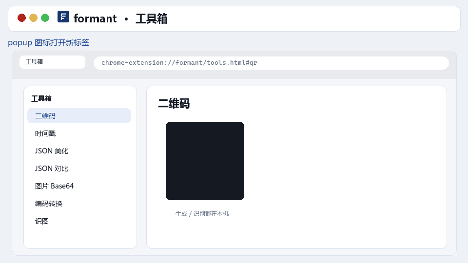

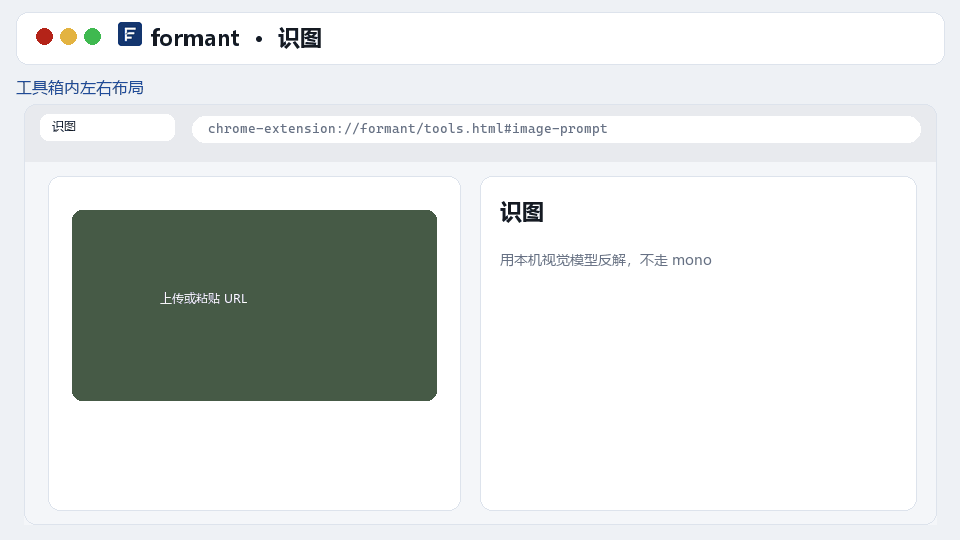

- 入口：popup 顶栏「工具箱」图标 → 新标签页 `tools.html`。页面外壳不滚动：左侧目录滚动；右侧标题栏固定在顶部，标题下面的内容上下滚动。总开关 `features.tools.enabled`（`option.html#features`，默认开启，不同步到 mono）。关闭后这些工具隐藏；若识图或 HLS 仍开启，图标与页面保留且只显示对应项；都关则图标隐藏。不改 `action.default_popup`，不走 mono。油猴单独新增 `userScripts` 权限，见下文「油猴（轻量）」。
- **来源**：功能范围参考 FeHelper（前端助手）2026.7.28（MIT）的 6 个工具，全部用原生 JS 重写；**未带入** jQuery、Vue、evalCore、AI 功能、条形码、捐赠入口。`$` 即 `document.querySelector`，另有 `$$`（`querySelectorAll`）。第三方库只有 qrcode-generator 1.4.4（MIT）和 zxing（Apache-2.0），见 `formant/tools/vendor/NOTICE`。企业查询是 formant 自研检索入口，**未嵌入**「企业背景信息查询」扩展的 Vue 打包、全站 content、DNR 或独立 popup。象棋人机参考 [chinese-chess-ai](https://github.com/shibing624/chinese-chess-ai) 的 αβ 与位置表（Apache-2.0，见 `xiangqi/NOTICE`），**未嵌入**其页面、样式和音效。
- **二维码**：生成（UTF-8，尺寸 / 前后景色 / 纠错 L-M-Q-H / 可选中心 logo，加 logo 自动用 H）、复制 PNG、下载 PNG；识别（选文件 / 拖拽 / 粘贴截图 / 图片 URL，优先浏览器 `BarcodeDetector`，没有则用 zxing，多种白边与缩放重试）。
- **时间戳**：当前时间可暂停；时间戳（自动判断秒 / 毫秒）↔ 日期；日期 → 时间戳；Windows FILETIME 互转；GMT-12…+12 与本机时区；世界时间表。
- **JSON 美化**：粘贴即格式化；缩进 2 / 4 / Tab，键排序（默认 / 升 / 降），压缩，Unicode → 中文，URL 解码，展开嵌套 JSON（字符串里的 JSON），兼容 JSONP 与 BOM；超过 2^53 的整数在文本里保持原样（树视图里以字符串显示）；报错带行列。输出区有「文本」与「树视图」，树视图复用网页 JSON 查看器 `viewer.js`（折叠 / 搜索 / 复制路径）。
- **JSON 对比**：JSON 模式先解析并（可选）忽略键顺序，给出新增 / 删除 / 修改清单（带路径与类型变化）和左右对齐行高亮；纯文本模式按行对比。
- **文件对比**：左右各放一个文件或一个文件夹（拖入，或点「文件 / 文件夹」）。文件夹是左右两列，每列有名称、大小、日期，同一行是同一个相对路径，缺的一侧留空；点一行看该文件。文本按行对齐，可忽略空白；大文件在后台逐行对比，只画可见行，不按体积截断。「隐藏相同」会藏起相同的行和相同的文件。「交换」对调左右，「刷新」按磁盘上的最新内容重读。上下箭头在文本里跳到上一处 / 下一处不同的行，在文件夹列表里跳到上一个 / 下一个不同的文件（只定位，不打开），快捷键是 Alt+↑ / Alt+↓。从文件回到文件夹列表按 Esc；全屏时 Esc 仍先退出全屏。文件夹列表可按文件名筛选，不改变「全部 / 有差异 / 仅一侧」。「复制差异」把当前列表里不同、仅左、仅右的路径复制成文本。排除默认跳过 `node_modules`、`.git`、`dist`，还可以再写 `*.log` 或目录名，用逗号或空格分隔；这些开关记在本机 `chrome.storage.local`（`formantCompareExclude`），不进配置 JSON。取消排除后，没有文件夹句柄时需要重新拖入才会读到那些目录。文本对比可选手动编码：自动、UTF-8、GBK。标题栏「全屏」铺满屏幕，再点或按 Esc 退出。差异色用 GitHub gist 的红删绿增。拖入或用按钮选择过的对比会出现在「最近」，点击直接打开，记录在本机 IndexedDB，不进配置 JSON，不同步。图片可并排、看差异像素、滑动对照。二进制只比较大小和内容摘要。一次最多 4000 个文件。只在本机读取，不上传。**未嵌入** WinMerge / Beyond Compare。
- **图片 Base64**：图片 → DataURI（选文件 / 拖拽 / 粘贴 / URL；显示原图与 DataURI 体积；可复制 DataURI / 纯 Base64 / CSS `url()` / ``）；Base64 / DataURI → 图片预览与下载（纯 Base64 自动嗅探 MIME）。
- **编码转换**：Unicode、URL、UTF-16（`\x` / `\u`）、Base64（UTF-8 安全，识别 URL-safe）、十六进制、HTML 实体（普通 / 深度转义与解码）、URL 参数解析（表格）、JWT 解码（只解码不验签）、字符串转义 / 反转义、MD5、SHA-1、SHA-256、Gzip 压缩 / 解压（原生 `CompressionStream`，结果为 Base64）。选一种方式即转换，输入变化同步更新。未做 AI 解码与 Proto Hex。
- **企业查询**：填企业名或 18 位统一社会信用代码，在天眼查 / 企查查 / 爱企查 / 启信宝等公开检索页打开新标签（回车默认天眼查，「常用四站」一次开四个）。可读取当前网页选区。最近关键字只存 `chrome.storage.local.formantCompanySearch`，不同步、不进 option-keys。不抓站、不注入网页、不加右键菜单。
- **象棋**：三种模式（人机 / 教学 / 双人，侧栏下拉切换）。点选走棋，合步过滤自杀与飞将；将死或困毙判负。刷新后从 `formantXiangqi` 恢复当前局。难度用下拉（入门～加力 / 自动）。教学在对方走完后用棋盘气泡建议应着，并说明为什么、思路是什么（本机着法，不走 GPT/mono）；气泡可点 × 关掉当前条，下一步仍会再出。可点「讲解提示」。双人同一棋盘轮走。棋盘按实物；走子滑动与 Web Audio 可关。不显示评分。
- **油猴**：右侧列表管理已安装脚本（开关、筛选、按当前页过滤、导出、删除）。新建 / 导入（粘贴、文件、URL）/ Greasy Fork 搜索 / 编辑走 `#userscript/...` 二级页。详见下文「油猴（轻量）」。
- **Lighthouse**：右侧是本机历史报告列表。新建测评走 Google PageSpeed Insights API（手机 / 桌面，性能 / 无障碍 / 最佳实践 / SEO），详情在 `#lighthouse/view/{id}`。不能测 localhost 或需登录的页面。报告只存 `formantLighthouse`（最多 20 条）。**未嵌入**官方 Lighthouse 扩展 `blipmdconlkpinefehnmjammfjpmpbjk`。不新增权限，不走 mono。
- **HLS**：休闲分组。添加 / 删除 / 设默认 m3u、txt 列表源。点播放弹出「New Tab 卡片」或「播放页」。数据仍是 `formantHlsSources`。显示与播放由 `features.hls.enabled` 控制，不另开开关。关闭后左侧不再列出 HLS，打开 `.m3u8` 也不再劫持，New Tab 第四卡也不再播。
- **边界**：除油猴外只在扩展自己的页面里运行，不注入网页，不上传内容；识别 / 获取图片 URL 时由扩展页直接 `fetch`（已有 `http(s)` host 权限）。扩展页 CSP 下不使用 eval。

#### 工具箱冒烟清单

1. 重载 formant：popup 顶栏仍是 6 个图标不挤，其中「工具箱」图标打开新标签页；翻译、书签、站点数据、扩展管理、设置照常。
2. 工具箱页左侧按「编码 / 检索 / 网页 / 休闲」分组，含二维码、文件对比，再到「企业查询」「油猴」「Lighthouse」「HLS」「象棋」以及「识图」，每项带图标、没有二级说明；组内拖动可调整顺序，刷新后保持；点「识图」在页内左右布局里上传图片出结果。
2h. 文件对比：左右拖入两个文本应出现左右对齐的行，删改是浅红、新增是浅绿；「隐藏相同」只留有差异的行和文件；上下箭头或 Alt+↑ / Alt+↓ 跳到上一处 / 下一处差异，从文件回到列表按 Esc；编码可选自动、UTF-8、GBK；「交换」对调左右；「刷新」重读磁盘；标题栏「全屏」铺满屏幕，再点或按 Esc 退出；「最近」里点一条应直接打开。两张图片可切换并排、差异、滑动；两个文件夹应分成左右两列（名称、大小、日期），同一行对同一个相对路径，仅一侧的行另一边是空的，默认不列出 `node_modules`、`.git`、`dist`；文件名框只缩小当前列表；「复制差异」复制当前列表里的差异路径；额外排除如 `*.log` 回车后生效。
2f. 油猴：右侧是脚本列表；点「搜索」进入二级页，可按关键字或当前站查 Greasy Fork；安装后回到列表，刷新匹配页应能跑脚本。
2g. Lighthouse：右侧是报告列表；点「新建测评」对一个公开 https 页跑完后应出现四项分数，并可打开详情。localhost 应提示不能测。
2c. 企业查询：输入公司名后点天眼查应新开检索页；「读当前页选区」能填入其它 http(s) 标签里选中的字。
2e. 象棋：红方走一步后棋子应滑到目标格并有落子声，AI 约 1 秒内回手；刷新工具箱页应还是刚才那局；教学在对方走完后应弹出应着气泡（含为什么/思路），点 × 关掉后下一步仍可再出；双人可轮流走；点「认真」后等级保持认真。
2a. JSON 美化顶部「+」新增页、「×」关闭页，各页输入互不影响；刷新后只剩一页空白页。
2b. 各面板按钮与输入框、拖拽区之间有正常间距，左右卡片顶部对齐。
3. 时间戳：`1388307215` → 北京时间 `2013-12-29 16:53:35`；`1388307215000` 自动判为毫秒；日期 → 时间戳往返一致；FILETIME 往返一致。
4. 编码转换：同一段中文做 Base64 / URL / Unicode / Hex / HTML 编码再解码应还原；MD5 `abc` 为 `900150983cd24fb0d6963f7d28e17f72`；JWT 能看到 header / payload。
5. 二维码：生成中文 + 链接，复制 / 下载后再用「识别」页识别回原文；加 logo 仍可识别。
6. JSON：`{"id":12345678901234567890}` 格式化后数字不变；故意写错应提示行列；树视图可折叠、搜索。
7. 对比：用示例，应列出修改 / 新增项，左右高亮对齐；纯文本模式按行对比。
8. 图片 Base64：拖入图片得到 DataURI 和体积；粘贴 DataURI 回到图片预览并可下载。
9. 关闭 `features.tools.enabled`：工具列表只剩识图与 HLS（若各自开启）；再关识图和 HLS：popup 图标隐藏。

### 油猴（轻量）

- 入口：工具箱「油猴」（`tools.html#userscript`）。总开关 `features.userscript.enabled`（`option.html#features`，默认开启，不同步到 mono）。关闭后停止注入，脚本仍留在本机。不另开 options 面板，不增加 popup 顶栏图标。
- **来源**：formant 自研。兼容常见 `// ==UserScript==`（`@match` / `@include` / `@exclude` / `@grant` / `@require` / `@resource` / `@connect` / `@run-at` / `@noframes`）以及 `GM_*` / `GM.*`（存值、样式、XHR、开标签、通知、剪贴板、菜单、资源）。可从文件、粘贴、`.user.js` URL 或 [Greasy Fork](https://greasyfork.org/) 安装。**未复制** Tampermonkey（本机 Edge `iikmkjmpaadaobahmlepeloendndfphd`）源码、图标或公钥。见 `formant/userscript/NOTICE`。
- **注入**：优先 `chrome.userScripts.register`（MAIN world，绕过页面 CSP）。新版 Chrome / Edge 可能要在扩展详情打开「允许运行用户脚本」。API 不可用时退回内容脚本 + `scripting.executeScript`。内容脚本匹配 `http://*/*`、`https://*/*`，`document_start`，含 iframe；`@noframes` 跳过子框。已打开的页面要刷新才套用新脚本。
- **存储**：脚本在 `chrome.storage.local.formantUserscripts`，GM 值在 `formantUsValues`。不走 mono，不接入 `option-keys.js`。
- **权限**：新增 `userScripts`。GM 跨域请求复用已有 `http(s)` host 权限；有 `@connect` 时限制主机。
- **边界**：只运行用户主动安装的脚本。若仍装着 Tampermonkey，同一脚本会跑两次，关掉其一。`@grant none` 与带 GM 的脚本都在页面 MAIN world 执行。不改 `action.default_popup`，禁止 `contextMenus.removeAll()`。

#### 油猴冒烟清单

1. 重载 formant：工具箱左侧有「油猴」；右侧是空列表和新建 / 导入 / 搜索。
2. 粘贴一段带 `// ==UserScript==` 与 `@match` 的脚本并保存：列表出现该项，刷新匹配页后脚本应执行。
3. Greasy Fork 搜索一个关键字，点安装：回到列表且脚本已启用。
4. 关掉列表开关或关掉 `features.userscript.enabled`：刷新匹配页后脚本不再运行。
5. 若提示「允许运行用户脚本」，到扩展详情打开后再重载。

### 滚动截屏（轻量）

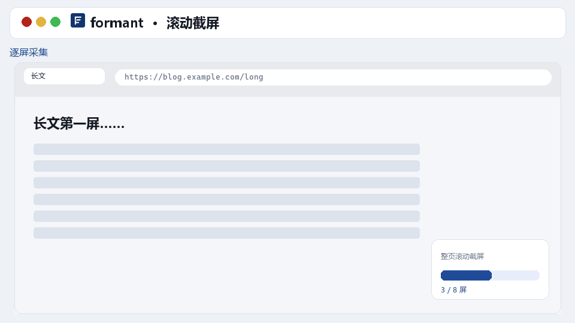

- 入口：`option.html#features` 总开关（`features.screenshot.enabled`，**默认开启**）+ 网页右键「formant 整页滚动截屏」/「formant 截取可见区域」。不另开独立 popup / options 页，不加入 popup 顶栏图标。
- **能力**：
  - **可见区域**：截当前视口，直接存 PNG。
  - **整页滚动截屏**：从页顶按视口高度滚动，`captureVisibleTab` 逐屏采集，OffscreenCanvas 拼接后下载 PNG。优先滚 `document`；页面本身不滚时再找最大的内部滚动容器，并按该容器裁切后拼接。
- **过程**：按需注入 `screenshot/content/main.js`（不写进 manifest 常驻匹配）。右下角 Shadow DOM 进度条，截每一屏前先藏起来。第一屏之后隐藏 `fixed` / `sticky`，避免顶栏重复出现。截完恢复滚动位置。点「取消」中止。
- **边界**：只处理 `http` / `https` 主框架；`chrome://` / `edge://` / 扩展页不可用。高度以开始时的 `scrollHeight` 为准（最多 80 屏），避免无限滚动/AutoPagerize 一直加长。超长页会缩小以适配画布上限。横向超出视口的部分不拼接。formant 自研，**未嵌入**第三方截屏扩展。不新增权限（复用 `activeTab` / `scripting` / `downloads` / `contextMenus` / 已有 host）。不改 `action.default_popup`，禁止 `contextMenus.removeAll()`。不走 mono。

#### 滚动截屏冒烟清单

1. 重载 formant（默认开启）；打开 `option.html#features`，应看到「滚动截屏」说明和开关，概览含「滚动截屏」。
2. 打开一篇普通 https 长文，右键应有「formant 整页滚动截屏」和「formant 截取可见区域」。选可见区域：应弹出另存为，图是当前一屏。
3. 选整页滚动截屏：右下角出现进度，页面自动往下滚，完成后另存为 PNG；打开图应是整页、顶栏不重复；原来的滚动位置应恢复。失败时应在页角看到红色/深色失败提示，而不是完全没反应。
4. 截屏过程中点「取消」：应停下来，不下载，页面恢复。
5. 关闭 `features.screenshot.enabled`：右键不再出现这两条截屏菜单；图片另存为 / 翻译菜单不受影响。
6. 在 `chrome://extensions` 上右键：不应出现该菜单（或点了会提示不能截系统页）。

### oolafOffice

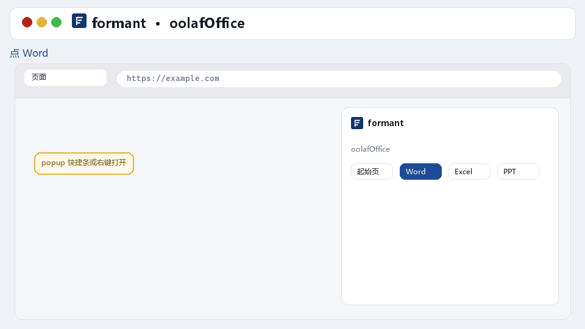

- 入口：`option.html#features` 总开关（`features.office.enabled`，**默认开启**）+ popup 主界面快捷条（起始页 / Word / Excel / PPT）+ 网页右键「formant oolafOffice」。设置页说明里可打开起始页。不另开独立 popup / options 页，不增加 popup 顶栏图标，不放进工具箱面板。
- **能力**：扩展页内编辑 Word（Quire）、Excel（Ledger）、PPT（Lectern）。打开和保存真实 `.docx` / `.xlsx` / `.pptx`，Word 还可打开 Word 97–2003 的 `.doc`（保存走另存为 `.docx`），Excel 还可打开 Excel 97–2003 的 `.xls`（保存走另存为 `.xlsx`），文件留在本机。最近文件存在扩展 origin 的 IndexedDB。Excel 里 Wingdings 2 空复选框（`£` / 0xA3）在画布和导出 PDF 时显示为 Unicode `□`，保存 xlsx 不改原文；中文与符号按 run 分字体绘制，避免宋体缺字变成空白框。Word 表格按 `tblGrid` 固定列宽排版，支持 `gridSpan` / `vMerge`、东亚竖排（`tbRlV`）、行级 `tblPrEx` 边框、`pctN` 底纹、百分比列宽 / 嵌套表 / `noWrap` / `gridAfter`。双栏节里宽于栏的行内图按栏宽等比缩小，不盖住邻栏。东亚文档网格（`docGrid type=lines`）对齐时按字号占格，不把 Normal 的自动倍数叠上去。Excel 自动换行按 CJK 字切行，内置 `numFmtId` 27–58 按年/月/日显示，主题东亚字体参与绘制。PPT 读取 `a:ea` / `a:cs` 与主题 `majorEa` / `minorEa`，表格单元格强制换行并支持竖排。西文主题字体（Arial / Calibri 等）缺东亚字形时回退微软雅黑 / 宋体。编辑器在窗口捕获阶段拦住浏览器抢键（F5 刷新、Ctrl+S 另存网页、Ctrl+P 打印、Ctrl+F 查找栏、Ctrl+R 刷新、Ctrl++/− 缩放、Backspace 后退等），快捷键走套件自己的命令；复制粘贴仍交给浏览器。
- **接入方式**：把上游 VibeOffice `public/` **向量复制**到 `formant/oolafoffice/`（独立目录，产品名 oolafOffice，不覆盖现有 formant 文件）。抽掉内联脚本以符合扩展 CSP；不注册 PWA Service Worker、不请求远程 updater。界面不出现 VibeOffice / GitHub Feedback。上游 Apache-2.0，见 `oolafoffice/LICENSE` 与 `NOTICE`（NOTICE 保留 VibeOffice 出处）。
- **边界**：不劫持系统文件关联；不把网页截图覆盖贴进桌面 Office。不新增权限。不改 `action.default_popup`，禁止 `contextMenus.removeAll()`。不走 mono。`oolafoffice/` 视为 vendor，不受单文件 500 行限制；formant 胶水 `office-bridge.js` / `popup-office.js` 仍遵守。

#### oolafOffice 冒烟清单

1. 重载 formant（默认开启）；打开 `option.html#features`，应看到「oolafOffice」说明、开关和「打开 oolafOffice 起始页」，概览含「oolafOffice」。点开 popup，主界面代理行下方应有 oolafOffice 快捷条。
2. popup 点起始页 / Word / Excel / PPT，以及任意 https 页右键「formant oolafOffice」子项，应各开对应扩展页；Word / Excel / PPT 能打字、填格或加形状。
3. 起始页「打开」本机 `.docx` / `.doc` / `.xlsx` / `.xls` / `.pptx`，再「另存为」下载，用桌面 Office 能打开。打开 `.doc` 后保存会另存为 `.docx`；打开 `.xls` 后保存会另存为 `.xlsx`。页面标题和关于框应写 oolafOffice，不是 VibeOffice；起始页没有 Feedback / GitHub 链接，About 与任务窗不写「2003 Web Edition」。
4. 关闭 `features.office.enabled`：popup 快捷条和右键菜单组都消失；截屏 / 图片另存为 / 翻译菜单不受影响。
5. DevTools 控制台无 CSP 内联脚本报错；Network 无 `vibeoffice.work/updater` 请求。
6. 打开含「绩效等级」勾选格的 xlsx（Wingdings 2 的 `£S £A £B £C`）：格子和导出 PDF 应显示 `□S □A □B □C`，不是英镑符号，也不是空白方框。另存为 xlsx 再用桌面 Excel 打开，原文与字体应仍是 Wingdings 2。
7. 打开带合并单元格、左侧竖排栏和浅灰表头的转正审批表类 `.docx`：列应对齐、竖排字在合并格内、表头是浅灰不是黑底、考评行有完整网格线，不应整块被推到下一页后变成无框正文。表比版心宽时应左右对称伸进页边（相对标题不偏右）。Ctrl + 滚轮应改 Quire / Ledger / Lectern 自己的缩放百分比，浏览器页不得跟着放大缩小。在 Lectern 按 F5 / Shift+F5 应放映而不是刷新扩展页；Ctrl+S / Ctrl+P / Ctrl+F / Ctrl+R / Ctrl+O 应走套件保存、打印、查找、对齐、打开，不应弹出浏览器另存为 / 打印 / 查找栏或刷新。
8. 打开含中文自动换行与「2026年3月11日」日期的 `.xlsx`：中文应在格内折行，日期应显示汉字年月日，不是序列号。打开含中文标题/表格的 `.pptx`：东亚字体应落到微软雅黑等，表格长句换行，竖排单元格用 writing-mode 而不是挤成横排。
9. 打开中文公文体 `.docx`（Normal 约 1.7 倍行距 + `docGrid type=lines` linePitch=312）：正文行距应接近桌面 Word，不应撑成两三倍行高。
10. Ledger 左键双击单元格应进入编辑，不应跳到 XFD1048576 一带；Ctrl+方向键停在已用区域边缘，不要整表末行末列。

### 词库包（插件化）

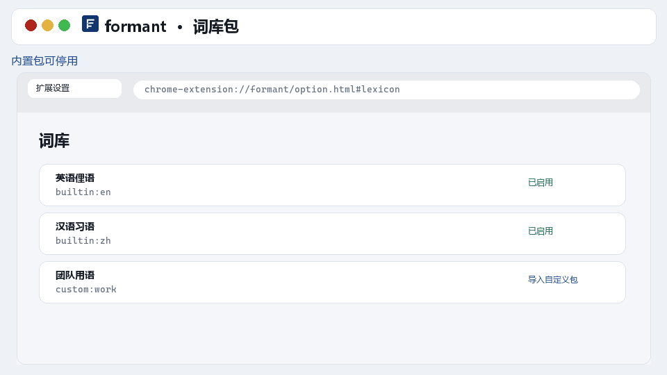

- **内置包**：`builtin:en|zh|ja|ko|tr`（俚语 + 部分习语/谚语），只读，可启用/停用
- **自定义包**：`chrome.storage`（`formantLexiconPacks` / `formantLexiconDisabled`）
- **管理页**：popup 齿轮 / 扩展选项 → `option.html`（`#newtab` / `#lexicon` / `#translate` / `#x-translate` / `#sync`）；mono 连接只在 `#sync`
- **默认项**：翻译模式与目标语言写入 `chrome.storage.local`，popup 与划词共用
- **导入 JSON**（单语言一个文件）：`{ "name", "lang", "entries": [{ "phrase", "meaning", "examples", "tags" }] }`
  - 默认 **新建** 自定义包；可选 **合并** / **替换** 当前自定义包（同 phrase 以导入为准）
  - **不会**改写内置包；多语言请拆多个文件分别导入
- 打分使用 `ensureLexiconReady()` 后的合并结果
- popup 标题旁显示扩展版本号（`manifest.version`）

### New Tab

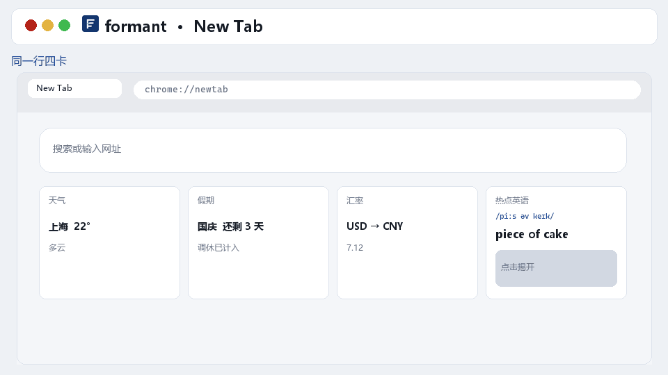

- 覆盖浏览器新标签页；布局可同步 mono `GET/PUT /client/newtab/home`
- 页签用自绘房子图标（`icons/newtab.ico` / PNG，品牌蓝 `#1f4b99` + 青绿窗）。覆盖页必须直接挂 `newtab.html`，地址栏才是空的；若再跳到扩展 URL，标签栏能出图标，但地址栏会变成 `chrome-extension://…/newtab.html`。Chrome/Edge 对真正的新标签覆盖页往往仍画默认文档图标。
- **Ctrl+Home**：命令 `formantNewtab`（不碰浏览器主页按钮，避免和系统主页冲突）。已有 New Tab 则激活该标签，没有则新开一页；当前页（如 V2EX）保留。New Tab 关闭时无效。可在 `chrome://extensions/shortcuts`（Edge 为 `edge://extensions/shortcuts`）改键。建议键仅在安装时写入，重载后若没绑上需在快捷键页手动设一次 Ctrl+Home。
- 齿轮打开 `option.html#newtab`（运行时扩展 URL，不硬编码扩展 ID），集中管理壁纸、遮罩、搜索框、天气城市，以及快捷链接是否在新窗口打开。
- **链接在新窗口打开**：写入主页 `baseConfig.openLinksInNewWindow`，随 `GET/PUT /client/newtab/home` 同步。开启后快捷图标与搜索结果在新标签打开，当前 New Tab 保持不动；默认关闭。文件夹仍在本页打开。快捷图标右上角另有外链按钮，一点即新标签打开，和点图标本体（默认当前标签）不冲突。
- 右上角「刷新」= 从当前 Client API Key **拉取**主页 + 更新卡片；「同步」= 把本机主页 **推送**到该 Key。换电脑后先配置同一把 Key；之后每次打开 New Tab 都会对账云端（本机空或 `revision` 落后则自动拉取，与天气卡片首次打开补拉同类）。空主页、或本机 `revision` 落后于云端时，点「同步」也不会覆盖云端较新布局。设置页顶栏显示 Key 指纹（不展示全文）。
- New Tab 图标布局存在 mono `web_newtab_home`（按 API Key），**不是** Chrome 浏览器书签；popup 书签树读的是本机 `chrome.bookmarks`。快捷图标默认用站点 `{origin}/favicon.ico`，裂图后再回退 Google `s2/favicons`；成功拉取后写入本机 `newtabCacheFavicons`（按 origin / 自定义 src，14 天内直接复用），**不同步** mono；换 Client API Key 时随其它 New Tab 缓存一并清空。已保存的 Google CDN 地址打开时仍先试站点根图标，手动填写的自定义图标仍有效。
- mono Base URL / Client API Key 写在 `chrome.storage.local`，并尽量镜像到 `chrome.storage.sync` 以便同账号换机。`option.html#sync` 有两份本机 JSON，导入都可以选文件或把文本贴进框。**本机钥匙**（`version: 2`）含同步的 Base URL 与 Client API Key、识图的 Base URL / API Key / Model、V2EX 的 Imgur Client ID、翻译的 DeepLX API Key。文件里没有的面板不动。`version: 1` 拒绝导入，需要重新导出。导入若更换 Client API Key，会清本机 New Tab / 手势缓存。**本机配置**（`version: 1`，`kind: formant-prefs`）不含密钥，含功能开关、New Tab 主页（含链接新窗口打开）、V2EX 选项、GitZip、自动翻页、手势、代理、X 推文样式、HLS 列表源地址、翻译模式与目标语言、工具箱顺序、Discord 输入翻译引擎、汇率币种。文件里没有的面板不动。词库包、油猴脚本、生词本、当前 HLS 播放会话不在这份文件里。New Tab 导入后仍可能被同一把 Key 的云端较新 `revision` 覆盖，需要留下时到 New Tab 点「同步」推上去。GitZip 不保存 PAT；代理没有账号密码。GPT 密钥在 mono Admin；DeepLX Key 只在本机。保存 New Tab 设置后，已打开的新标签页会通过 local storage 自动更新。
- **天气·万年历 / 下一个假期 / 汇率 / HLS**：同一行四卡（`1.35fr×4`）。天气与万年历合成一张卡，右上角用与假期/汇率相同的翻转图标 3D 切换，默认天气，当前面存在本机 `formantWxFace`（不进 mono、不进钥匙/配置 JSON）。天气面六日预报下方空带里有一只走动的巴哥：按住抚摸、点一下挑逗，点空地会走过去。动作跟当天天气（和天气卡同一份 `iconDay` / 气温）：晴天蹦跶，下雨头顶乌云落雨，下雪头顶乌云飘雪，≥30° 吐舌喘气，≤5° 发抖，打雷会吓一跳。只在天气面活动，翻到万年历即暂停，不进 mono、不进钥匙/配置 JSON。万年历按中国历，周一为一周之始：格子上方是阳历，下方是农历（初一写月份，含闰月）；节日为蓝色、节气为绿色，都不铺底；只有国务院放假日铺浅红底、阳历数字为红色，连着的区间首日左侧圆角、末日右侧圆角（内置 2025–2027，并合并本机假期缓存里较新的区间）。月历固定 6 周，避免换月时把同一行其它卡撑高。左右箭头换月，点年月弹出选月（动画与添加链接/生词本相同），弹层里可改年或回今天。假期与汇率合成一张卡，右上角用与热点英语/生词本相同的翻转图标 3D 切换，当前面存在本机 `formantHxFace`（不进 mono、不进钥匙/配置 JSON）。第四卡是 HLS 迷你播放：空闲时与其它卡同玻璃底，标题 HLS，中间 `empty-status`（暂无播放 / 暂无播放源），右上角播放按钮播已保存源（优先 `result.m3u8`，否则默认源）。工具箱点播放并选「New Tab 卡片」后也会铺深色画面；hover 出切台、音量、打开完整播放页（当前 m3u）。播放不落盘，刷新第四卡回到 empty。`formantHlsSession` 只记上次播放位置和一次性投放，不进钥匙/配置 JSON。天气刷新时卡片节点会留下以免拆掉画面。后台 `chrome.alarms` 每 10 分钟刷新天气接口，并在假期缓存跨天时顺带补拉假期（汇率/主页不动），分别写入 `newtabCacheWeatherAt` / `newtabCacheHolidaysAt` / `newtabCacheExchangeAt`；天气卡片展示「N 分钟前更新」，逐日预报在周几上方显示月-日（如 10-08），假期一面常驻显示「今天 M月D日 周X」，假期与汇率在数据超过 24 小时时才追加琥珀色「N 天前更新」提示。假期进行中时，左侧只留「当前是某假期」和距下一个假期的大号天数，天数下面带该假期的日期区间（不再显示 0 天、当前假期起止和今天日期），右侧固定 3 个假期（名称、日期区间和天数）。假期内左边是下一个假期，右边是再往后的 3 个，例如国庆期间左边是元旦，右边是春节、清明节、劳动节。不是假日时，右边是最近的 3 个，包含左边正在倒计时的那个。缓存条数不够时会自动再拉。不在假期内时，左侧仍是「某假期还有 N 天」加日期和今天。打开新标签页时还有兜底：天气超过 30 分钟、假期缓存跨天或汇率超过 24 小时会自动补拉。汇率卡片是 1 USD 兑换所选币种；右上角刷新旁的编辑按钮可调显示条数（滑块 1–5），并拖拽排序、更换币种。币种下拉覆盖全球流通法币（含越南盾，按字母排在 VES 与 VUV 之间）。编辑框可搜索国家或货币：搜「美元」或 USD 会列出使用美元的国家，选中国家即选中对应货币。列表上方有一行换算：输入金额并选择币种，折合人民币；列表行距在 1–5 条时都留出空隙，5 条也不再挤成一行贴一行。偏好存在本机 `formantExchange`，不进 mono，不进钥匙 JSON，可随 `option.html#sync`「本机配置」导出；换 Client API Key 不会清掉。需 New Tab 开启且已配置 mono。
- 天气 / 汇率 / 节假日等中台代理接口见 mono Formant 配置
- **热点英语**：与天气、假期/汇率、HLS 同一行（`1.35fr×4`）；默认展示 `formant.vocab.card_size` 个词（默认 5）；美式 IPA 标在单词上方（始终可见）；释义+谐音默认马赛克，点击揭开；单词喇叭「英→中」只读一遍；「全部发音」按序读完；剔除记「已会」并补位。已会词与当前卡按 Client API Key 隔离。接口 `GET/POST /client/newtab/vocab*`；模型 `formant.vocab.model_key`。右上角可 3D 翻到「生词本」：划词译完后会马上记下（词两边的标点会去掉，句子仍不记）；翻译框要等这轮输入停住，同一轮里打出的半截词会被最后的词换掉。句子、中文和其他语言不记。it、he、if、to、on 这类功能词也不记：冠词、代词、介词、连词、疑问词，以及 be/do/have 和情态动词。aaaaaa 这种连着同一字母，或 qweadg、asdf、qwerty 这种键盘乱按、字母组合不像英文的，也不记。已经在列表里的会在打开新标签页时拿掉。最近 5 条直接显示英文、音标、译文和朗读。音标是有道英汉词典的美式音标，划词和翻译框记下单词后都会取。释义也取自有道英汉词典，带词性（n. / v. / adj. …）、每个词性最多 3 个义项、一行放下，放不下以省略号截断（悬停看全文）；词典里没有的词仍用 Google 译文。朗读中文时去掉词性标记，只读前两个义项。打开新标签页会给旧的无词性释义补查词典。不用 Google 译到中文时附带的译文拼音（如 juéding）或音节拆分（如 ˈout look）。词典里没有的词不显示音标。打开新标签页会把空的、拼音或拆分换成音标。没有单词时卡片中央显示「暂无生词」。移出只从本机删掉。超过 5 条可分页查看。列表在 `formantStudyWords`，当前哪一面在 `formantVocabFace`，都不进 mono，也不进钥匙导入导出。生词本没有刷新按钮。
- 第一行四卡等宽，汇率内容垂直居中

#### New Tab 热点英语冒烟

1. 执行 mono 增量 SQL `20260812-formant-vocab.sql`、`20260813-formant-vocab-ipa.sql`、`20260813-formant-client-key-scope.sql`；Admin 配置 `formant.vocab.model_key` 与可选 `formant.vocab.card_size`。
2. 重载 formant → 打开 New Tab：第一行第三张为热点英语（第四张是 HLS）；单词上方应有 IPA；点释义区域揭开谐音；喇叭发音；图标贴在词旁。旧缓存无音标时打开页面会自动补，不必整卡换词。
3. 剔除一词 → 该行换新词；整卡刷新不再出现已剔词。
4. 断网时若有缓存仍可展示上次单词。

### 书签同步

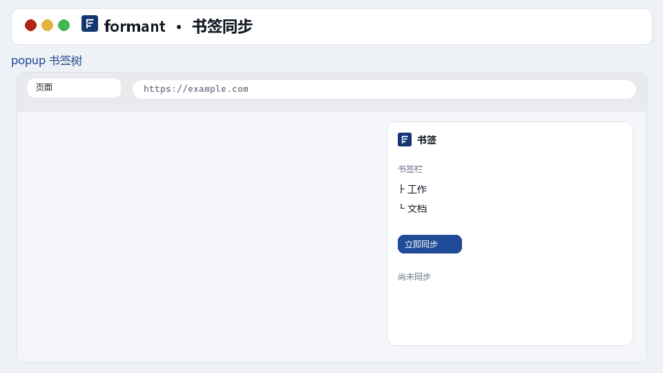

- 监听书签变更防抖同步；手动同步按钮（popup 或 `option.html#sync`）
- `POST /client/bookmarks/sync`（并集写入当前 Client API Key 的书签树；空文件夹列表不会覆盖云端）
- 换 Client API Key 时会清掉本机 New Tab / 词卡 / 手势缓存，避免串数据
- Stereo 读的是 Admin `formant.bookmarks.web_api_key_id` 绑定的那一把，不是全站池

### 图片另存为

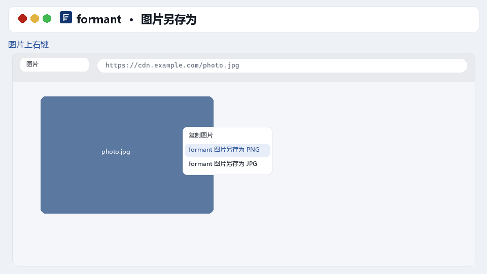

- 图片上右键 → **formant 图片另存为** → PNG / JPG
- 需要 `downloads` 权限；转码在扩展内完成

### Telegram 受限媒体下载（轻量）

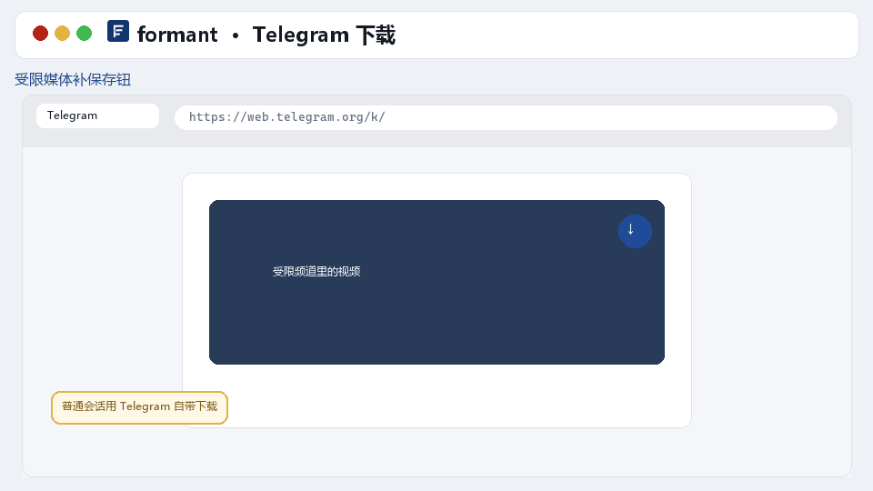

- 入口：仅 `option.html#features` 总开关（`features.telegram.enabled`，**默认开启**）。不另开独立 popup / options 页。
- **能力**：在 Telegram Web（`web.telegram.org` / `webk` / `webz`，含 `/k/` 与 `/a/`）的受限群组、私密频道里，为当前账号已经能看到的 **图片和视频** 补保存按钮。允许保存的普通会话不插按钮。
- **交互**：查看器或气泡右上角 Shadow DOM 下载钮；视频显示右下角进度。大文件在页面 MAIN world 拼装后用 `<a download>` 保存，不经 Service Worker 传整段 data URL。
- **边界**：formant 自研，不整包嵌入第三方 Telegram 下载扩展，不接其云端站点，不新增 `identity` 或其它权限。不改 `action.default_popup`。首版不做贴纸 / 音乐 / 语音 / Stories。

#### Telegram 下载冒烟清单

1. 重载 formant；默认开启时打开 `web.telegram.org`（建议 `/k/`）受限群，图片与视频应出现下载钮并能保存。popup / 翻译 / 手势不受影响。
2. 普通允许保存的会话不应出现 formant 按钮（用 Telegram 自带下载）。
3. 关闭 `features.telegram.enabled` 后刷新 Telegram Web：按钮与进度条消失。

### GitZip（公开 GitHub 仓库）

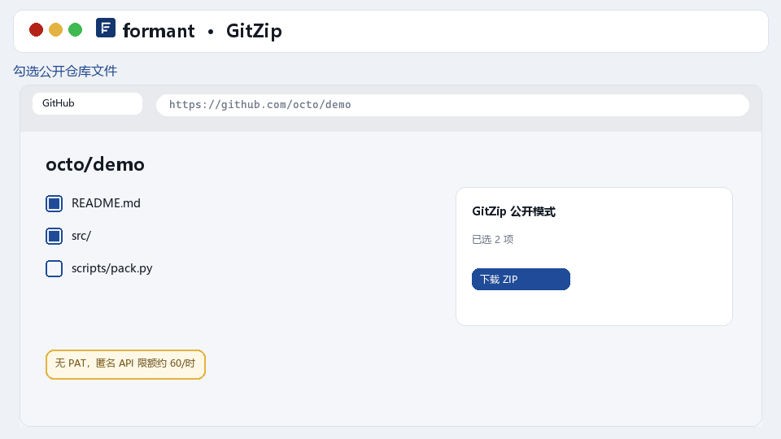

- 入口：GitHub 仓库根目录、`tree` 目录或 `blob` 文件页面；以及其右键 **formant GitZip** 子菜单。
- 能力：勾选文件/目录、多选下载、当前文件/目录下载、整仓下载；单文件直接保存，其余生成 ZIP。分支名包含 `/` 时会通过页面分支信息和公开 branches API 解析。
- 勾选框注入会忽略自身 DOM 变更并暂停 MutationObserver，避免页签久置后切回时 checkbox 反复拆装闪烁。
- 设置：`option.html#gitzip` 可选「复选标记 + 双击」「仅复选标记」「仅双击」和悬浮进度面板主题；设置键为 `chrome.storage.local.formantGitzip`。
- 范围：仅公开仓库。没有 GitHub PAT、OAuth、`gitzip.org` 回调、token 同步或 token 存储；所有 API 请求均不附带 `Authorization`。
- 限制：匿名 GitHub API 通常约为每小时 60 次请求。大目录、整仓下载或频繁重试可能被限流，面板会给出公开模式提示。
- 权限用途：复用已有 `downloads`、`storage`、`contextMenus`、`scripting` 权限；manifest 显式声明 `https://api.github.com/*`，GitHub 内容脚本仅匹配 `*://github.com/*`。

#### GitZip 冒烟清单

1. 在 `chrome://extensions` 重载 formant；点击工具栏图标仍必须打开 formant popup。
2. 打开公开仓库的目录页，验证每个文件/目录行的勾选、三种选择方式、悬浮面板主题、单文件下载、单目录 ZIP 与多选 ZIP。
3. 在文件页和目录页分别检查右键 **formant GitZip** 的「已选项 / 当前 / 整仓」；同时确认翻译、图片另存为和 V2EX sov2ex 菜单仍存在。
4. 测试名称含 `/` 的分支；触发匿名限流时应显示公开模式错误，且不要求或保存令牌。
5. 关闭 `features.gitzip.enabled` 后刷新 GitHub：页面标记、悬浮面板和 GitZip 菜单必须消失，formant popup 不受影响。

### V2EX Plus（GPLv3）

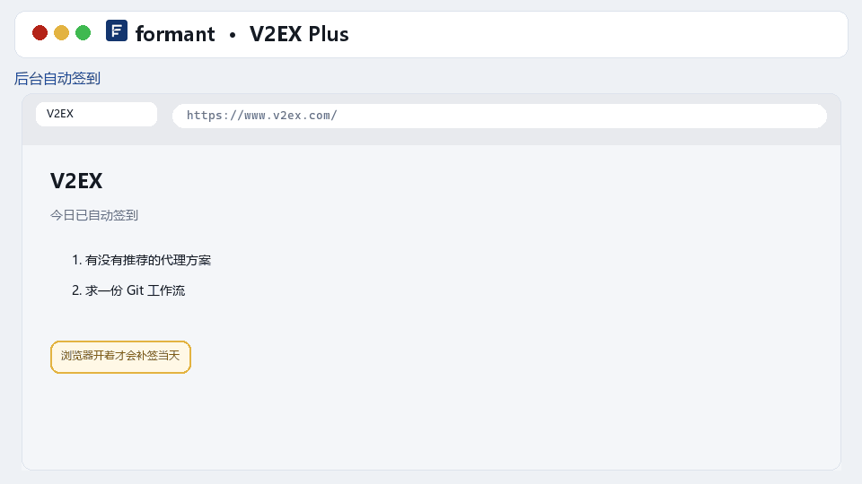

- 入口：`option.html#v2ex`；总开关在 `option.html#features`。
- **自动签到**：登录 V2EX 后，**浏览器保持运行时**后台每 5 分钟检查一次；当天成功后用 `checkinDate` 防重复。电脑关机或浏览器未打开时不会签到，下次打开浏览器后再补签当天。可选择签到成功通知。
- **消息角标**：每 3 分钟读取未读数；未登录时显示 `!`，只更新 badge，绝不替换 formant 图标或改变 popup 点击行为。
- **页面增强**：主题预览/忽略/折叠/跳转、楼层号/相关回复/楼中楼（打开主题时先 **4 路并发**拉齐评论分页，最多 100 页，再按 @ / #楼层 组树，避免跨页断档；整条移动到父级下方、不重复展示；子树紧凑展示——隐藏头像列、压缩内边距、虚线分隔，可展开/收起）、楼主回复背景默认关闭、图片解析与 Imgur 上传、用户悬停卡、vDaily、sov2ex、Base64 解码等均由上游同名 `chrome.storage.sync.options` 字段控制。Imgur 上传需在本机填写自己的 Client ID，不会写入扩展包或同步对象；该 ID 随 `option.html#sync` 的本机钥匙 JSON 一起导出。
- **管理**：同页管理标记用户、屏蔽用户与忽略主题；样式商城与浏览器快捷键页也保留在该面板。
- **权限用途**：`alarms` 用于签到与未读轮询，`notifications` 用于签到成功提醒，`declarativeNetRequest` 仅为 `*.sinaimg.cn` 图片写入微博 referer；V2EX/Imgur/Sina 的 host pattern 在 manifest 中显式列出。
- **许可与来源**：整合自 [V2EX Plus 2.1.3](https://github.com/sciooga/v2ex-plus)，适用 GPL-3.0。完整许可证和修改说明位于 [`formant/v2ex-plus/COPYING`](formant/v2ex-plus/COPYING) 与 [`formant/v2ex-plus/NOTICE`](formant/v2ex-plus/NOTICE)；分发包含该整合的 formant 时必须遵守 GPLv3。

### GitZip 许可与来源

- GitZip 公开下载交互基于 [GitZip for github](https://github.com/KinoLien/gitzip) 1.0.5 的 MIT 许可来源改造；formant 版删除 PAT、OAuth、`gitzip.org` 回调、独立 popup/options 与 action 图标控制。
- 归属、完整 GitZip MIT 文本与 JSZip / Pako / FileSaver.js 的上游 notices 位于 [`formant/gitzip/LICENSE`](formant/gitzip/LICENSE)、[`formant/gitzip/NOTICE`](formant/gitzip/NOTICE) 和 [`formant/gitzip/THIRD_PARTY_NOTICES`](formant/gitzip/THIRD_PARTY_NOTICES)。
- formant 因已整合的 V2EX Plus 衍生模块整体仍按 GPLv3 分发；GitZip 相关来源保留其 MIT 归属。

### AutoPagerize（自动翻页）

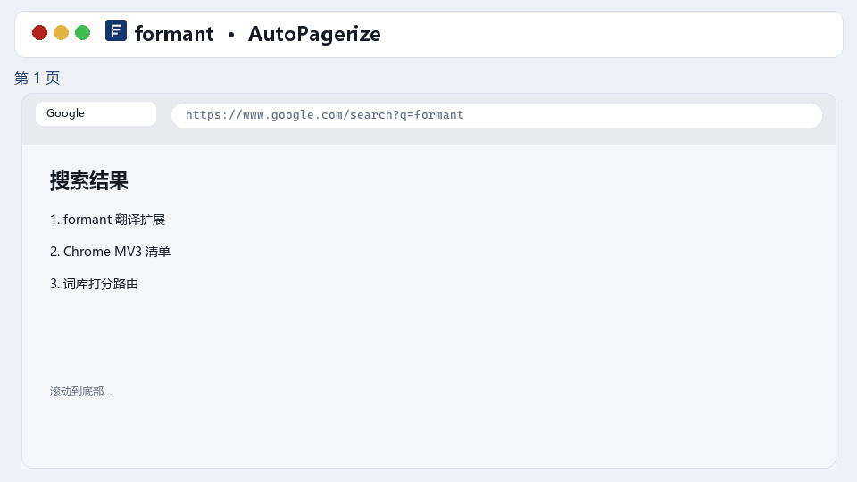

- 入口：`option.html#autopagerize`；总开关在 `option.html#features`。
- **能力**：滚动到页面底部时自动加载下一页并插入当前页面；内置约 2400 条站点 XPath 规则（来自 AutoPagerize wedata 项目），另有 Google / Bing 等优先内置规则覆盖过期 XPath，同时支持 microformat（`rel="next"`、`autopagerize_*` class）。
- **设置**：可开关底部状态条、编辑排除 URL 列表（通配符或正则）；设置键为 `chrome.storage.local.formantAutopagerize`。
- **架构**：内容脚本注入所有 HTTP/HTTPS 页面（`all_frames: false`）；同域下一页由 content script 带 cookie 拉取，跨域才走 background SW。解析后用 DOMParser + XPath 提取内容插入。`linux.do` 硬排除（Discourse 自带无限滚动）。
- **许可与来源**：核心逻辑整合自 [AutoPagerize 0.3.9](http://autopagerize.net/) by swdyh，GPL 许可（兼容 formant GPLv3 分发）；扩展抽象层 MIT。许可证和修改说明位于 [`formant/autopagerize/LICENSE`](formant/autopagerize/LICENSE) 与 [`formant/autopagerize/NOTICE`](formant/autopagerize/NOTICE)。

#### AutoPagerize 冒烟清单

1. 重载 formant 后打开有分页的 Google / Bing 搜索结果页（需页面底部仍有「下一页」链接，如 `#pnnext`），滚动到底部应自动加载下一页。
2. 在 `option.html#autopagerize` 编辑排除 URL，保存后刷新对应页面应停止自动翻页。
3. 关闭 `features.autopagerize.enabled` 后刷新页面：自动翻页应停止。
4. 打开 linux.do 列表页滚动到底：不应出现 AutoPagerize 下一页插入。
5. 确认 formant popup、翻译、GitZip、V2EX 功能不受影响。

### 鼠标手势（轻量）

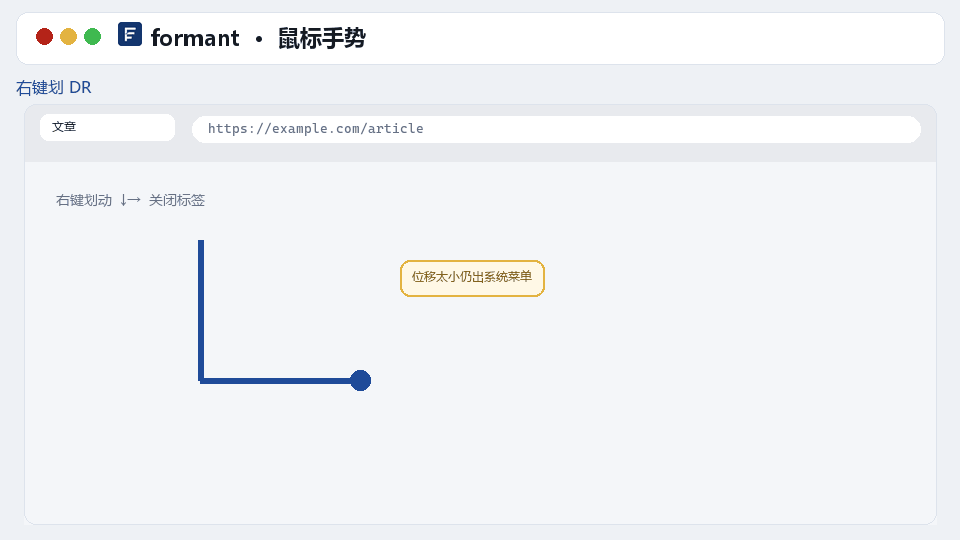

- 入口：`option.html#gestures`；总开关在 `option.html#features`（`features.gestures.enabled`，**默认关闭**）。
- **能力**：http/https 页面右键划动。识别按转折分段（忽略起点抖动），↓→ 与 →↓ 不会认反。另支持宽松圆圈 `O`（不必闭合；绕行序列也按圈匹配）和 ✕ `X`（可两笔交叉）。默认：`L` 后退、`R` 前进、`UD` 刷新、`DR` 关闭当前标签、`U` 到顶、`D` 到底。刷新走 `chrome.tabs.reload({ bypassCache: true })`。
- **CRUD**：行为 ID 固定（`back` / `forward` / `reload` / `closeTab` / `scrollTop` / `scrollBottom`）。设置页可添加、绘制改绑、删除；同一手势不能绑两个动作。
- **预览**：列表同时显示箭头/圈/✕ 与图片。绘制后上传 `POST /client/gestures/preview`，对象 key 为 `formant/gestures/{apiKeyId}/{action}/{previewId}.png`；改绑或删除按行为 ID 清掉该目录旧图。
- **交互**：位移小于阈值仍弹出系统右键菜单；输入框 / 可编辑区域不触发；轨迹用 Shadow DOM 折线 + 动作名。
- **设置键**：`chrome.storage.local.formantGestures`（本机缓存）；revision / 同步时间另存 `formantGesturesRevision` 等。
- **同步**：同一组 Client API Key；「刷新」=`GET /client/gestures` 拉取，「同步」=`PUT /client/gestures` 上传。无个人数据时返回内置默认（`fromDefault`）。空映射不会覆盖云端已有自定义。总开关不同步。
- **边界**：formant 自研，行为参考 smartUp 常用映射，**未嵌入**其 MV2 源码。不改 `action.default_popup`，不调用 `contextMenus.removeAll()`，不新增权限。`edge://`、`chrome://`、Edge Add-ons / Chrome Web Store、PDF 查看器由浏览器禁止注入，无法使用手势。若本机仍开着 smartUp，请只启用其中一个。

#### 鼠标手势冒烟清单

1. 重载 formant；确认默认关闭时普通网页右键菜单（翻译 / 图片另存为）正常。
2. 打开 `features.gestures.enabled`，刷新普通网页：默认方向手势各一次；小幅右键仍出系统菜单。
3. 在设置页把「刷新」画成不闭合的圈，网页上画近似圈应强刷（含缓存）；把「关闭当前标签」画成两笔 ✕，交叉即可，不必一笔连成。
4. 改绑后列表同时出现新预览图和箭头/圈/✕；再改一次，S3 旧图应被删掉。
5. 划词浮标、GitZip 勾选、V2EX 双击回顶、AutoPagerize 仍可用。
6. 关闭总开关后刷新页面：轨迹与动作全停，formant popup 不变。
7. 设置页改一条映射后点「同步」，换机（同一 Client API Key）点「刷新」应拿到相同映射与预览 URL。

### 代理（轻量）

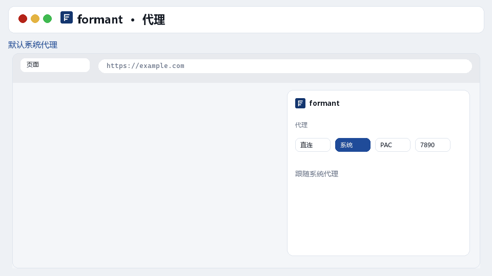

- 入口：`option.html#proxy`；总开关在 `option.html#features`；popup 顶部快捷切换（保持 formant `default_popup`）。
- **默认**：首次使用为**系统代理**；固定代理表单默认端口 **7890**。
- **能力**：直连 / 系统代理 / PAC（URL 或导入 `.pac` 脚本）/ 最多 5 条固定 HTTP·HTTPS·SOCKS4·SOCKS5；bypass 列表可编辑。
- **设置键**：`chrome.storage.local.formantProxy`（`activeId` + `profiles` + `pac`）。
- **权限**：manifest `proxy`；关闭总开关时 `chrome.proxy.settings.clear`。
- **边界**：概念参考 [Proxy SwitchyOmega](https://github.com/FelisCatus/SwitchyOmega)，**未嵌入**其 MV2 源码包；首版不支持代理用户名/密码（需认证时用系统代理或自建 PAC）。PAC 同时存在 URL 与本地内容时优先本地脚本。

#### 代理冒烟清单

1. 重载 formant，确认安装时请求 `proxy` 权限；新配置默认应落在「系统代理」。
2. `option.html#proxy` 添加一条 SOCKS5（如 `127.0.0.1:7890`），列表中点选应立即生效；端口默认值为 7890。
3. 导入或粘贴 PAC 后点「启用 PAC」，`chrome://net-internals/#proxy`（或系统网络）应反映 pac_script；popup 出现「PAC」芯片。
4. popup 顶部在「直连 / 系统 / PAC / 自定义」间切换，当前项高亮。
5. 关闭 `features.proxy.enabled` 后，浏览器代理控制应被清除；重新开启后按 `activeId` 恢复。

### 扩展管理（轻量）

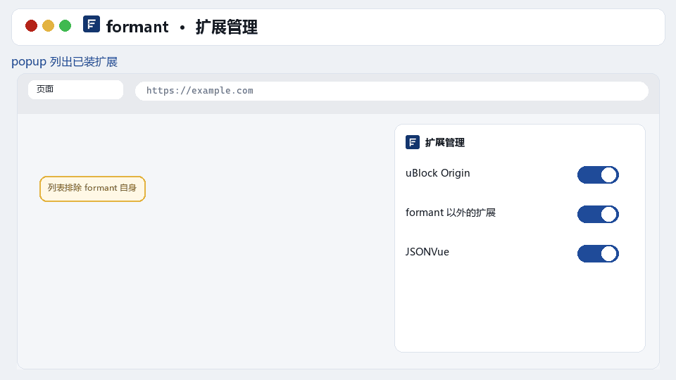

- 入口：popup 顶栏「扩展」二级视图；完整管理仍在 `option.html#extensions`；总开关在 `option.html#features`。
- **能力**：列出本机已安装扩展（排除 formant 自身与非 `extension` 类型）、按名称/描述/ID 搜索、一键启用/禁用；有 `optionsUrl` 时可打开选项页。
- **权限**：manifest `management`。
- **边界**：概念参考「扩展管理器」，**未嵌入**其 MV2 源码包；不做分组/锁定/别名/导入导出/角标。

#### 扩展管理冒烟清单

1. 重载 formant，确认安装时请求 `management` 权限。
2. popup 顶栏扩展图标（站点数据旁）进入列表；搜索可用，切换开关立刻反映到 `chrome://extensions`。
3. `option.html#extensions` 仍可完整管理。
4. formant 自身不出现在可禁用列表。
5. 关闭 `features.extensions.enabled` 后 popup 入口隐藏，设置页只读提示。

### 站点数据（Cookie / Storage）

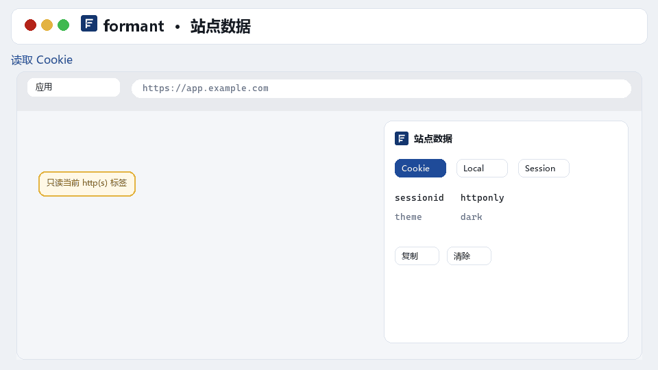

- 入口：popup 顶栏「站点数据」二级视图；总开关在 `option.html#features`（`features.siteData.enabled`）。
- **能力**：进入视图时读取当前数据源，并后台预读另外两份；切换 Cookie/Local/Session 走缓存（点「刷新」才重拉）。工具条「刷新 / 复制 / 清除」+「列表 / 原文」。列表键值完整保留在 DOM（超长两行省略，可选中 Ctrl+C）；行内图标复制整条 `key=value`、删除（确认后）；当前 Tab 一键清除（确认后）。不再提供「键 / 值」与底部「完整 JSON」复制。
- **权限**：manifest `cookies`（Storage 复用已有 `scripting` + host_permissions）。
- **边界**：概念参考「Cookie和Storage提取器」，**未嵌入**其源码；不做任意写入或跨站批量导出。

#### 站点数据冒烟清单

1. 重载 formant，确认安装时请求 `cookies` 权限。
2. 打开普通 https 页 → popup「站点数据」→ 自动读出 Cookie；切 Local/Session 应马上切（已预读则不再转圈）；「刷新 / 复制 / 清除」与单条删除可用。
3. 在 `chrome://` 页应提示无法提取。
4. 关闭 `features.siteData.enabled` 后顶栏入口隐藏。
5. 确认 `action.default_popup` 仍为 formant popup，翻译/书签/代理正常。

#### V2EX 冒烟清单

1. 在 `chrome://extensions` 重载 formant；点击图标仍应打开 formant popup。
2. 打开 `option.html#v2ex`，逐项改动后刷新 V2EX 页面；验证三个管理列表、样式商城、快捷键页和恢复默认。
3. 登录 V2EX 后，点击「立即签到」或等待 alarm；确认写入 `checkinDate`，并在开启 `chickinNote` 时收到通知。
4. 验证未读数 badge；未登录时只显示 `!`，formant 图标不变。
5. 验证列表预览/忽略、详情楼中楼与用户卡、sov2ex 右键菜单，以及它与「用 formant 翻译」菜单共存。多页主题（如 `?p=1`）应先出现加载提示，再按楼层展开全部回复后组树。
6. 关闭 `features.v2ex.enabled` 后刷新 V2EX：签到、badge、页面增强、DNR 和 sov2ex 菜单均应停止。

### JSON / JS / CSS 美化

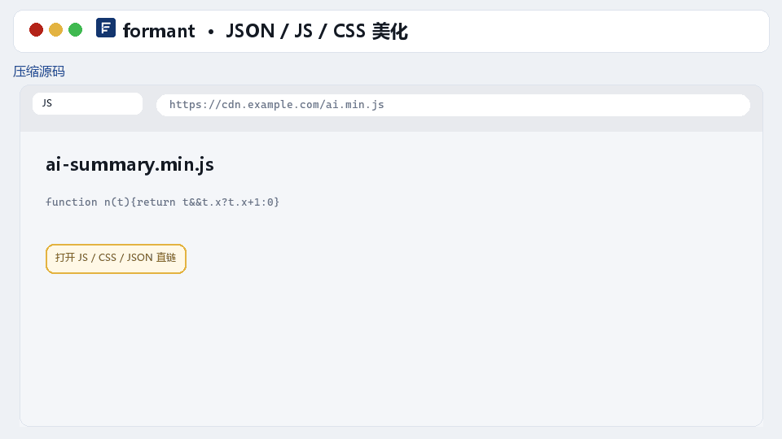

- 整页查看器：直接打开 JSON、`.js` / `.mjs` / `.cjs`、`.css`（浏览器以纯文本 `PRE` 呈现的那种，例如 `ai-summary.min.js`）时自动美化。
- JSON 仍是树视图；JS / CSS 是格式化源码，带关键字/字符串/注释高亮，可 Pretty / Raw、搜索、复制。工具栏可下载美化后的文件，文件名取当前地址或请求路径。
- DevTools 面板（原「formant JSON」，现名 **formant**）同时收集 JSON / JS / CSS 响应。
- 自研格式化，不嵌入 prettier / js-beautify。历史能力来自 `oolaf-web-json-prettify`。

#### 代码美化冒烟清单

1. 重载 formant 后打开 `https://www.ghxi.com/wp-content/plugins/wp-opt/static/js/ai-summary.min.js?ver=1773018332`：应变为缩进后的 JavaScript，可 Copy pretty，Download 应保存美化后的 `.js`。
2. 打开一个 `.css` 纯文本地址：应出现格式化 CSS。
3. 打开 JSON URL：仍走原来的树视图。
4. F12 → formant 面板：页面加载的 JS/CSS 请求应出现在左侧，Response 为美化源码。

## 与 mono 的配置键（服务端）

在 Admin → Formant / 系统配置中维护（勿写入扩展仓库）：

| 键 | 用途 |
| --- | --- |
| `formant.translate.chatanywhere_api_key` | GPT 通道 |
| `formant.translate.chatanywhere_base_url` | Completions URL |
| `formant.translate.chatanywhere_model` | 默认模型 |
| `formant.translate.google_base_url` | Google gtx 根地址 |
| `formant.weather.*` / `formant.exchange.base_url` | New Tab 部件 |
| `formant.vocab.model_key` | 热点英语所用 AI 模型（Admin 下拉选模型池 key，空=默认激活） |
| `formant.vocab.card_size` | 热点英语词数（默认 5，范围 1–12） |
| `formant.bookmarks.web_api_key_id` | Stereo 书签绑定的 Client API Key 数字 id（不存密钥） |
| `formant.newtab.default_home` | 无个人布局时的默认 New Tab JSON |

Client 路由前缀：`/api/v1/client/newtab/*`、`/api/v1/client/gestures`、`/api/v1/client/gestures/preview`、`/api/v1/client/bookmarks/sync` 等。

## 设计与协作文档

- [`DESIGN.md`](DESIGN.md) — 扩展视觉与 CSS 变量
- [`LOGS.md`](LOGS.md) — 更改记录（只在文末按时间追加）

## 版本

当前扩展版本见 [`formant/manifest.json`](formant/manifest.json) 的 `version` 字段（现为 `1.8.154`）。
